<section class="ope-hero" markdown>
<div class="ope-hero__text" markdown>

<p class="ope-eyebrow">Command line tool · open source · MIT</p>

# Turn a folder of Obsidian notes into one polished PDF

<p class="ope-lead">Wiki links, embeds, callouts, Mermaid, Dataview and more, rendered without Obsidian. Every folder becomes a numbered section, with a table of contents and your header and footer. Runs on your machine or in CI.</p>

=== "Linux / macOS"

    ``` { .bash .ope-cmd }
    curl -LsSf uvx.sh/obsidian-pdf-exporter/install.sh | sh && ope setup --yes
    ```

=== "Windows"

    ``` { .powershell .ope-cmd }
    powershell -ExecutionPolicy ByPass -c "irm https://uvx.sh/obsidian-pdf-exporter/install.ps1 | iex; ope setup --yes"
    ```

``` { .bash .ope-cmd }
ope export ./MyVault/Handbook --title "Team handbook"
```

<div class="ope-actions" markdown>
[Get started](getting-started/installation.md){ .md-button .md-button--primary }
[:fontawesome-brands-github: GitHub](https://github.com/Spenhouet/obsidian-pdf-exporter){ .md-button }
</div>

</div>
<div class="ope-stage" markdown>

<div class="ope-window" markdown>
<p class="ope-window__bar"><span></span><span></span><span></span>Handbook/Release process/Release process.md</p>

````markdown
--8<-- "examples/_showcase/Handbook/Release process/Release process.md"
````

</div>

<p class="ope-stage__arrow" aria-hidden="true"><code>ope export</code></p>

<div class="ope-paper-stack">
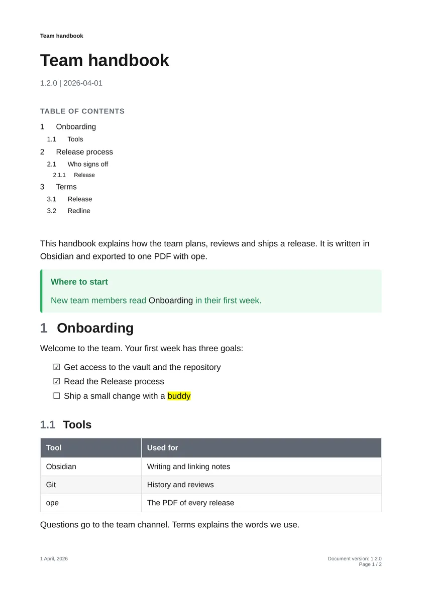
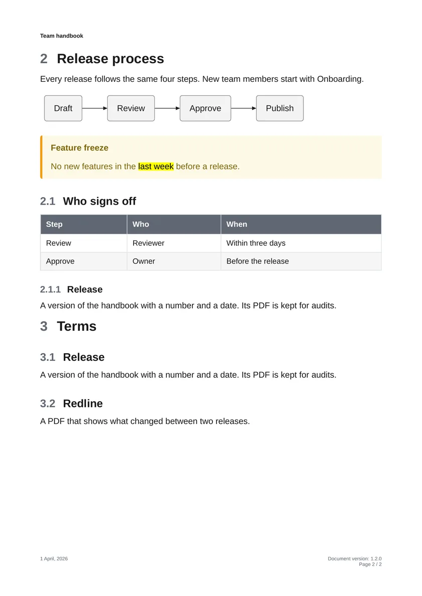
</div>

</div>
</section>

<section class="ope-section" markdown>

<p class="ope-kicker">The basics</p>

## A folder in, one finished PDF out

<div class="ope-split" markdown>
<div markdown>

Point `ope` at a folder of your vault. Every subfolder becomes a numbered section, and the note inside it with the same name (`Onboarding/Onboarding.md`) its text. Links between notes, embeds and attachments are resolved across the whole vault.

```text
Handbook/
├── Handbook.md         → first page
├── Onboarding/         → 1 Onboarding
├── Release process/    → 2 Release process
└── Terms/              → 3 Terms
```

``` { .bash .ope-cmd }
ope export ./Handbook --title "Team handbook" --version 1.2.0
```

- Title block, table of contents and numbered headings
- Running header and footer with title, version, date and page numbers
- The default template, or your own CSS

</div>
<div class="ope-pages-pair">
<figure>

<figcaption>Page 1: title and table of contents</figcaption>
</figure>
<figure>

<figcaption>Page 2: header, footer, page number</figcaption>
</figure>
</div>
</div>

### Everything in your notes, on paper

<div class="grid cards ope-shots" markdown>

-   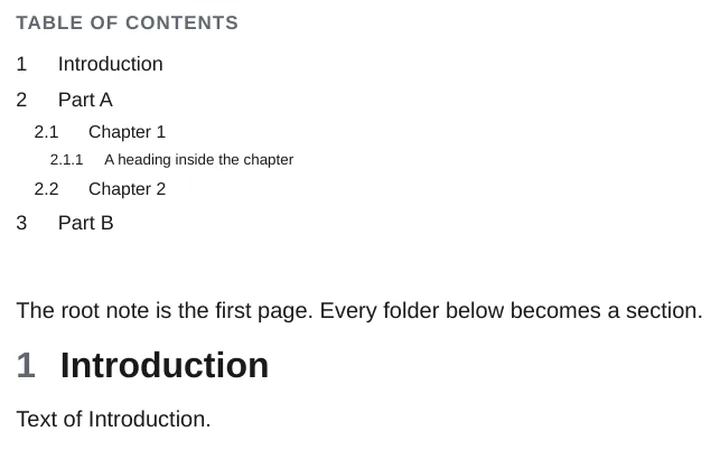{ width="720" height="450" loading="lazy" decoding="async" }

    __Folders become sections__

    Numbered headings and a table of contents.

    [:octicons-arrow-right-24: Folder Notes](plugins/folder-notes.md)

-   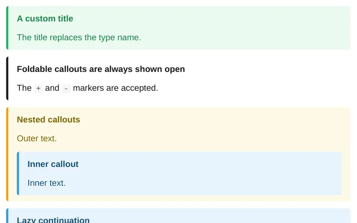{ width="720" height="450" loading="lazy" decoding="async" }

    __Callouts__

    Every type, custom titles, nested and foldable.

    [:octicons-arrow-right-24: Callouts](obsidian/callouts.md)

-   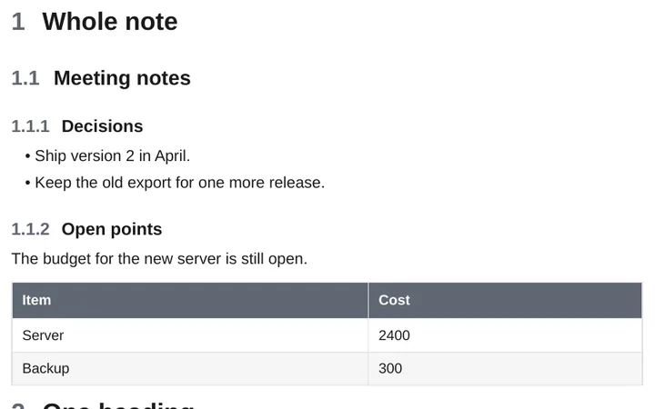{ width="720" height="450" loading="lazy" decoding="async" }

    __Embeds__

    Notes, headings, blocks, images, SVG and PDF pages.

    [:octicons-arrow-right-24: Embeds](obsidian/embeds.md)

-   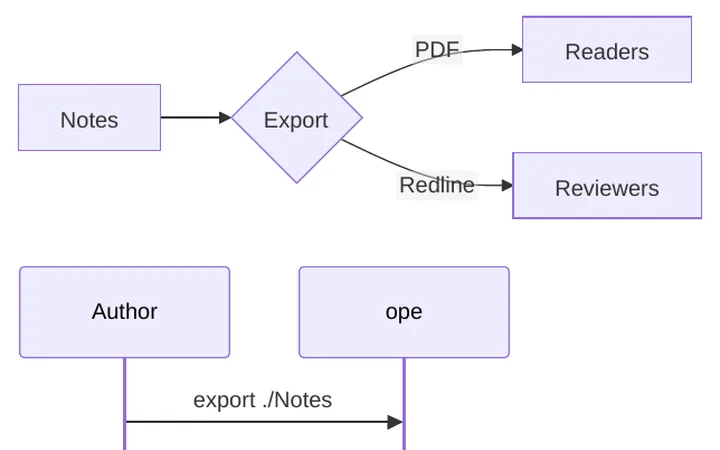{ width="720" height="450" loading="lazy" decoding="async" }

    __Mermaid diagrams__

    Rendered to sharp vector graphics.

    [:octicons-arrow-right-24: Mermaid](obsidian/mermaid.md)

-   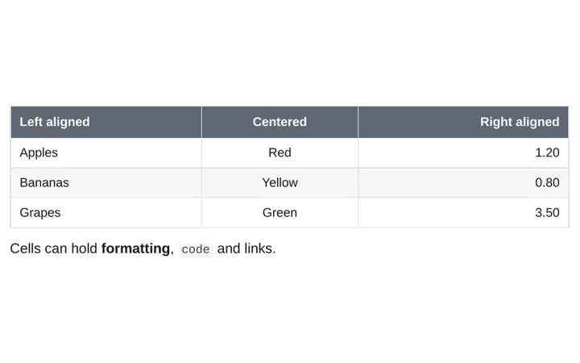{ width="720" height="450" loading="lazy" decoding="async" }

    __Tables__

    Alignment, wide tables on landscape pages.

    [:octicons-arrow-right-24: Tables](markdown/tables.md)

-   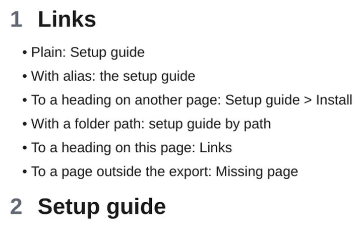{ width="720" height="450" loading="lazy" decoding="async" }

    __Wiki links__

    Links to notes, headings and blocks work in the PDF.

    [:octicons-arrow-right-24: Wiki links](obsidian/wiki-links.md)

</div>

</section>

<section class="ope-section" markdown>

<p class="ope-kicker">Obsidian syntax and community plugins</p>

## Your plugins, rendered to static pages

The syntax of popular community plugins becomes tables, lists and drawings in the PDF, with no Obsidian running.

<div class="grid cards ope-shots" markdown>

-   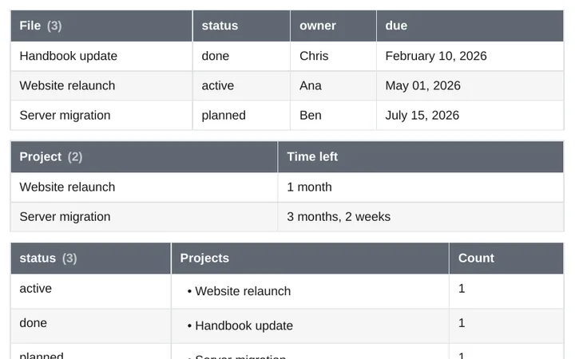{ width="720" height="450" loading="lazy" decoding="async" }

    __Dataview__

    Queries, inline fields and DataviewJS.

    [:octicons-arrow-right-24: Dataview](plugins/dataview.md)

-   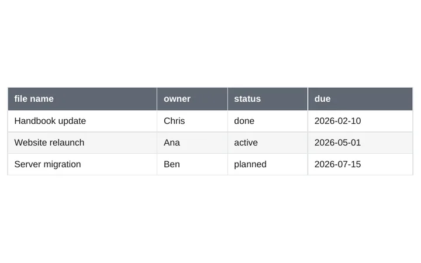{ width="720" height="450" loading="lazy" decoding="async" }

    __Bases__

    Table views of your notes.

    [:octicons-arrow-right-24: Bases](obsidian/bases.md)

-   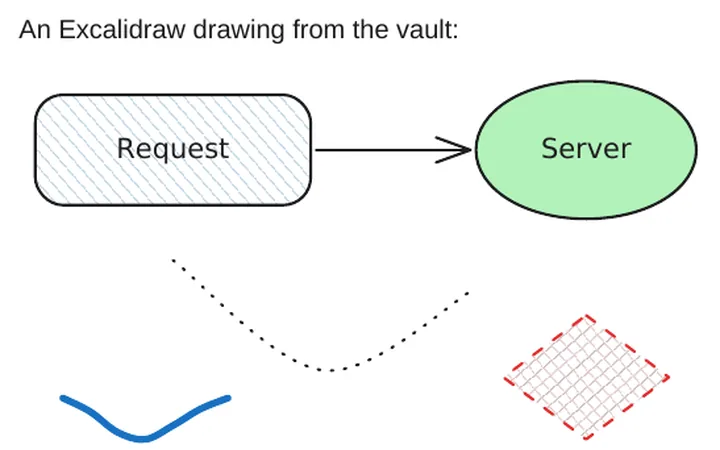{ width="720" height="450" loading="lazy" decoding="async" }

    __Excalidraw__

    Drawings, hand-drawn text included.

    [:octicons-arrow-right-24: Excalidraw](plugins/excalidraw.md)

-   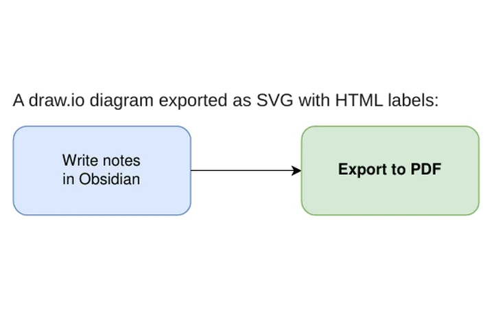{ width="720" height="450" loading="lazy" decoding="async" }

    __draw.io__

    Diagrams from `.drawio.svg` and `.drawio.png`.

    [:octicons-arrow-right-24: draw.io](plugins/drawio.md)

-   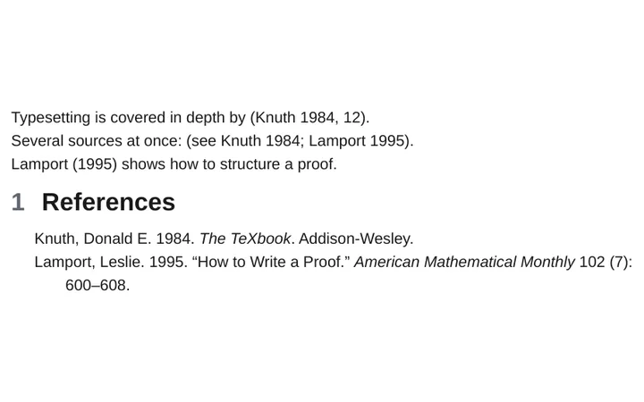{ width="720" height="450" loading="lazy" decoding="async" }

    __Citations__

    Pandoc citations and a bibliography.

    [:octicons-arrow-right-24: Citations](plugins/citations.md)

-   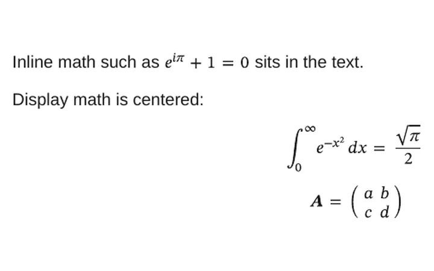{ width="720" height="450" loading="lazy" decoding="async" }

    __Math__

    LaTeX math, inline and as blocks.

    [:octicons-arrow-right-24: Math](markdown/math.md)

</div>

Also: [highlights and comments](obsidian/highlights-comments.md), [tasks](obsidian/tasks.md), [footnotes](markdown/footnotes.md), [properties](obsidian/properties.md), [Meta Bind](plugins/meta-bind.md), [Block Link Plus](plugins/block-link-plus.md), and [plugins you write yourself](plugins/write-a-plugin.md).
{ .ope-more }

</section>

<section class="ope-section ope-feature" markdown>

<p class="ope-kicker">Redline</p>

## See every change between two versions

Two git commits of your notes become one tracked-changes PDF: inserted text underlined in blue, removed text struck through in red, a change bar in the margin and a summary of every changed section. Made for reviews, approvals, audits and release notes.

``` { .bash .ope-cmd }
ope redline ./Policy --from-commit v1.0.0 --to-commit v1.1.0
```

<figure class="ope-redline-hero">
<picture>
  <source media="(max-width: 44.9375em)" srcset="img/redline/overview.png" width="857" height="493">
  
</picture>
</figure>

<div class="ope-redline-pair">
<figure>

<figcaption>Blackline with change summary</figcaption>
</figure>
<figure>

<figcaption>Side by side, with <code>--blame</code>: who changed what, and when</figcaption>
</figure>
</div>

<div class="ope-actions" markdown>
[How Redline works](redline/index.md){ .md-button .md-button--primary }
[Redline in CI](redline/usage.md#in-ci){ .md-button }
</div>

</section>

<section class="ope-section" markdown>

<p class="ope-kicker">Templates and styling</p>

## Make it look like your documents

A template is a folder with CSS, a running header and footer and page rules. Start from a recipe and change what you need.

<div class="ope-templates">
<a href="templating/" class="ope-template">
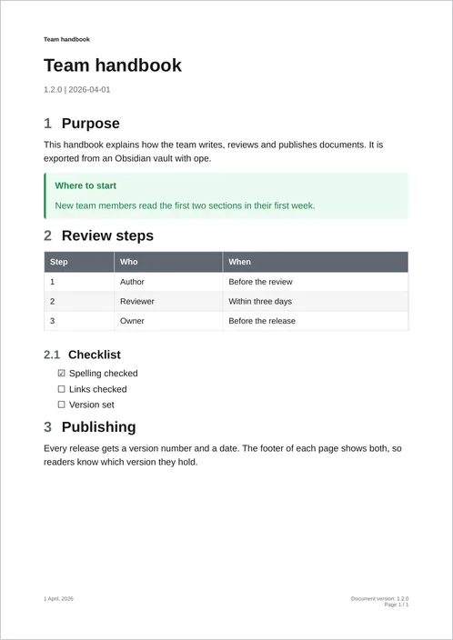
<span>Default</span>
</a>
<a href="templating/recipes/#company-letterhead" class="ope-template">
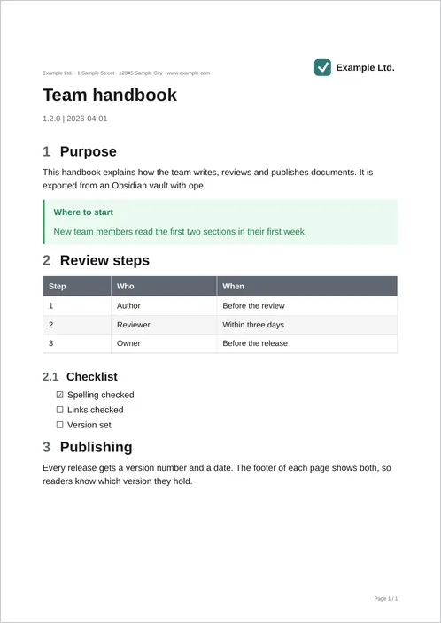
<span>Letterhead</span>
</a>
<a href="templating/recipes/#confidentiality-label" class="ope-template">
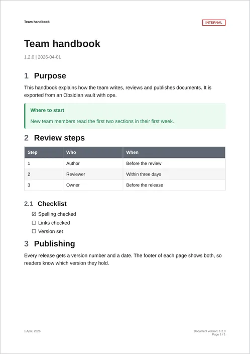
<span>Confidentiality label</span>
</a>
<a href="templating/recipes/#dark-variant" class="ope-template">
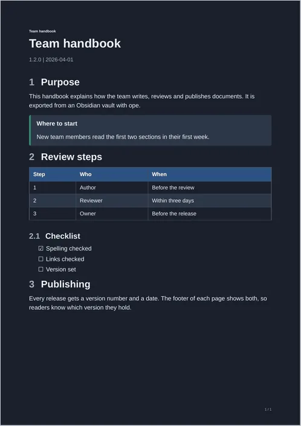
<span>Dark variant</span>
</a>
</div>

<div class="ope-actions" markdown>
[Templates and styling](templating/index.md){ .md-button }
[Recipes](templating/recipes.md){ .md-button }
</div>

</section>

<section class="ope-section" markdown>

<p class="ope-kicker">How it works</p>

## Plain Markdown in, PDF out, anywhere

<ol class="ope-steps">
<li><strong>Write in Obsidian</strong><span>Your notes stay plain Markdown files in a folder, in git or not.</span></li>
<li><strong>Run <code>ope</code></strong><span>On your machine or in CI. Obsidian does not need to be installed.</span></li>
<li><strong>Share the PDF</strong><span>One numbered document, or a redline for the review.</span></li>
</ol>

<div class="ope-agents" markdown>

**Working with an AI agent?** `ope` ships a Claude Code plugin with a skill, and an [`llms.txt`](llms.txt) for any other agent. [Use with AI agents :octicons-arrow-right-24:](agents.md)

</div>

</section>

<section class="ope-cta" markdown>

## Export your first folder in a minute

``` { .bash .ope-cmd }
curl -LsSf uvx.sh/obsidian-pdf-exporter/install.sh | sh && ope setup --yes
```

<div class="ope-actions" markdown>
[Quick start](getting-started/quick-start.md){ .md-button .md-button--primary }
[Read the introduction](intro.md){ .md-button }
[:fontawesome-brands-github: Star on GitHub](https://github.com/Spenhouet/obsidian-pdf-exporter){ .md-button }
</div>

</section>
