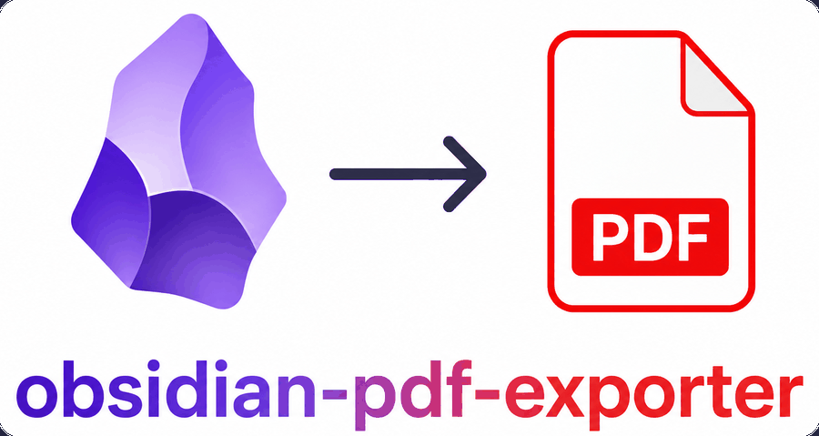
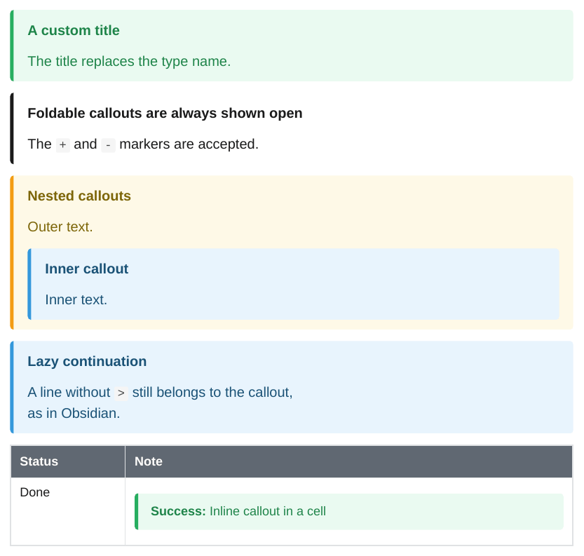

<div class="ope-hero" markdown>



<p class="ope-tagline">Export a folder of Obsidian notes to one PDF, with wiki links, embeds, callouts, Mermaid, math and community plugin syntax. Runs locally or in CI.</p>

[Get started](getting-started/installation.md){ .md-button .md-button--primary }
[View on GitHub](https://github.com/Spenhouet/obsidian-pdf-exporter){ .md-button }

</div>

## What it does

<div class="grid cards" markdown>

-   :material-folder-file-outline: __A folder becomes a document__

    Every folder is a section, every folder note its text. Headings are numbered and listed in a table of contents.

    [:octicons-arrow-right-24: Folder structure](obsidian/structure.md)

-   :simple-obsidian: __Obsidian syntax__

    Wiki links, embeds of notes, headings and blocks, callouts, highlights, comments, tasks, footnotes, Mermaid, math and Bases.

    [:octicons-arrow-right-24: Obsidian features](obsidian/index.md)

-   :material-puzzle-outline: __Community plugins__

    Dataview queries, Meta Bind views, Excalidraw drawings, citations, Block Link Plus ranges and draw.io diagrams render to static content.

    [:octicons-arrow-right-24: Plugins](plugins/index.md)

-   :material-file-compare: __Redline__

    A tracked-changes PDF between two git commits, for reviews and audits.

    [:octicons-arrow-right-24: Redline](redline.md)

-   :material-palette-outline: __Templates__

    CSS, running header and footer and page rules. A letterhead or a new footer is a folder with a few files.

    [:octicons-arrow-right-24: Templates and styling](templating/index.md)

-   :material-robot-outline: __Ready for AI agents__

    A Claude Code plugin with a skill, plus `llms.txt` for any other agent.

    [:octicons-arrow-right-24: Use with AI agents](agents.md)

</div>

## From note to PDF

Each feature page shows the Markdown next to the rendered PDF. For example a callout:

<div class="ope-example" markdown>
<div markdown>
<p class="ope-label">Markdown</p>

````markdown
--8<-- "examples/callouts/callouts.md"
````

</div>
<div markdown>
<p class="ope-label">PDF</p>



</div>
</div>

## Get going in a minute

=== "Linux / macOS"

    ```bash
    curl -LsSf uvx.sh/obsidian-pdf-exporter/install.sh | sh && ope setup --yes
    ```

=== "Windows"

    ```powershell
    powershell -ExecutionPolicy ByPass -c "irm https://uvx.sh/obsidian-pdf-exporter/install.ps1 | iex; ope setup --yes"
    ```

Then export a folder of your vault:

```bash
ope export ./MyVault/Handbook --title "Team handbook"
```

The PDF lands in `./.export/Team handbook.pdf`. Next: the [quick start](getting-started/quick-start.md).
