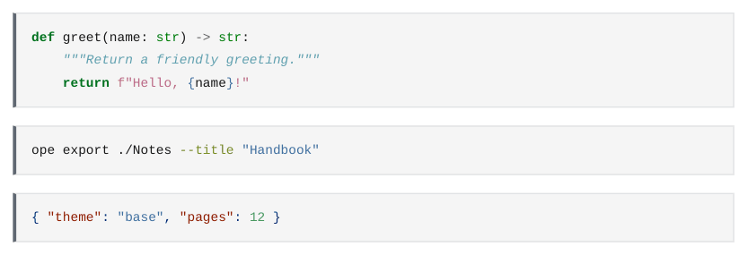

# Code blocks

Fenced code blocks are highlighted by pandoc for the language after the fence. Inline code uses a monospace font.

<div class="ope-example" markdown>
<div markdown>
<p class="ope-label">Markdown</p>

````markdown
--8<-- "examples/code-blocks/code-blocks.md"
````

</div>
<div markdown>
<p class="ope-label">PDF</p>



</div>
</div>

Code is shown as written. Wiki links, embeds, block IDs and `%%` comments inside code are not processed, as in Obsidian. A `mermaid` block is drawn as a diagram, see [Mermaid](../obsidian/mermaid.md). `dataview` blocks are run by the [Dataview](../plugins/dataview.md) plugin.

The colours of the highlighting come from pandoc's default style. A template can change them with the `span.kw`, `span.st`, `span.co` (and so on) classes inside `pre code`.
