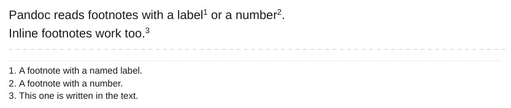

# Footnotes

Footnotes work as in Obsidian: a reference `[^1]` with a definition `[^1]: text` anywhere in the note, or an inline note `^[text]`. Each note is shown at the bottom of the page where it is referenced. The numbers run through the whole document.

<div class="ope-example" markdown>
<div markdown>
<p class="ope-label">Markdown</p>

````markdown
--8<-- "examples/footnotes/footnotes.md"
````

</div>
<div markdown>
<p class="ope-label">PDF</p>



</div>
</div>

The dashed line in the picture marks where empty page space was cut out.

- The labels of each note (and of each embedded note) are kept apart, so `[^1]` on one page never shows the text of `[^1]` on another page.
- When two references use the same label, each gets its own copy of the note, with its own number.
- A note that holds a list, a table or another block besides paragraphs cannot be placed at the bottom of the page. It stays in the list of notes at the end of the document, with its number.

| Option | Effect | Default |
| ------ | ------ | ------- |
| `-O footnotes=page\|end` | `page` shows notes at the bottom of the page. `end` keeps one list of notes at the end of the document. | `page` |

The notes use CSS [paged media footnotes](https://www.w3.org/TR/css-gcpm-3/#footnotes) (`float: footnote`). To style them, see the [CSS reference](../templating/css-reference.md#footnotes).
