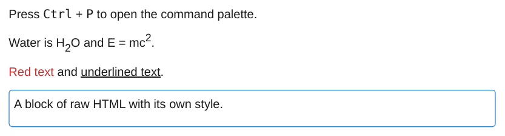

# Inline HTML

HTML in a note is passed to the PDF as it is, so tags such as `<kbd>`, `<sub>`, `<sup>`, `<u>` or a styled `<div>` work.

<div class="ope-example" markdown>
<div markdown>
<p class="ope-label">Markdown</p>

````markdown
--8<-- "examples/inline-html/inline-html.md"
````

</div>
<div markdown>
<p class="ope-label">PDF</p>



</div>
</div>

HTML comments (`<!-- ... -->`) are removed. WeasyPrint draws the HTML, so scripts and interactive elements have no effect.

## Tags without a closing tag

Some HTML elements hold raw text or are never drawn: `<style>`, `<script>`, `<title>`, `<textarea>`, `<iframe>`, `<noscript>`, `<xmp>`, `<noembed>`, `<noframes>`, `<template>`, `<select>` and `<plaintext>`. When the opening tag of such an element has no closing tag, an HTML parser reads everything after it, to the end of the document, as its content. A sentence like "Anything inside <style> is printed as text" would then hide every later section of the PDF.

Obsidian renders a note block by block, so a stray tag hides at most its own block there. The export keeps all text: an opening tag of one of these elements without a closing tag is shown as text, as it was typed, and the export prints a warning that names the note and the tag:

```text
Warning: <style> in Notes/Tools.md has no closing tag, kept as text
```

A tag counts as closed when its closing tag follows in the same paragraph, or, for a tag at the start of a line (an HTML block), anywhere later in the note. `<plaintext>` has no closing tag in HTML, so it is always shown as text. Tags inside code stay as they are. An HTML comment without its closing `-->` is also shown as text and hides nothing.
