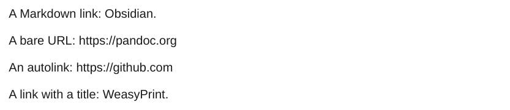
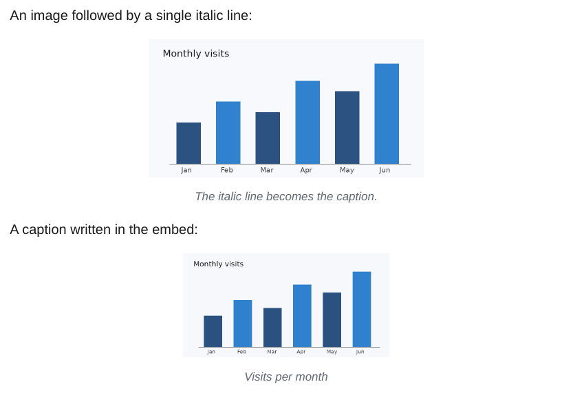
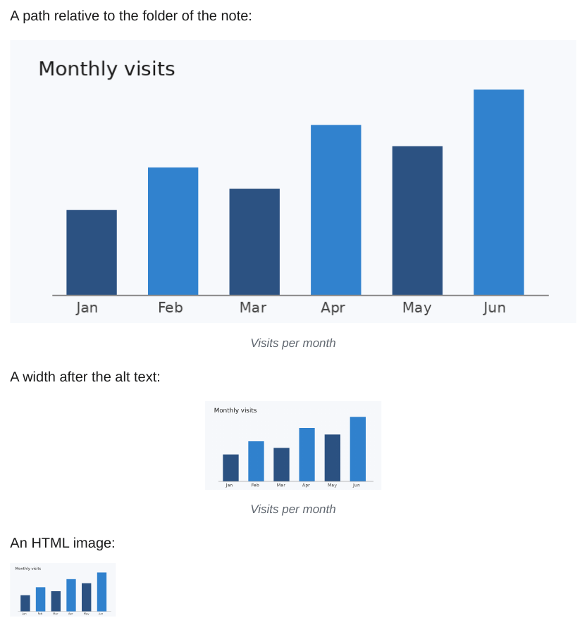

# Links and images

## Links

<div class="ope-example" markdown>
<div markdown>
<p class="ope-label">Markdown</p>

````markdown
--8<-- "examples/links/links.md"
````

</div>
<div markdown>
<p class="ope-label">PDF</p>



</div>
</div>

- A Markdown link and an autolink in angle brackets become links in the PDF.
- A bare URL stays plain text. Pandoc's reader does not turn it into a link, while Obsidian does. Wrap it in `<...>` to get a link.
- In print, links have the text colour. Links between pages of the export are [wiki links](../obsidian/wiki-links.md).

## Images

<div class="ope-example" markdown>
<div markdown>
<p class="ope-label">Markdown</p>

````markdown
--8<-- "examples/images/images.md"
````

</div>
<div markdown>
<p class="ope-label">PDF</p>



</div>
</div>

- An image is at most as wide as the text and never split across pages.
- A Markdown link to a note, such as `[text](Page.md)`, works like a [wiki link](../obsidian/wiki-links.md).
- A single italic line right below an image becomes its caption.
- Image sizes and the full embed syntax are on the [Embeds](../obsidian/embeds.md) page.

## Local images

<div class="ope-example" markdown>
<div markdown>
<p class="ope-label">Markdown</p>

````markdown
--8<-- "examples/markdown-images/markdown-images.md"
````

</div>
<div markdown>
<p class="ope-label">PDF</p>



</div>
</div>

- The path of `` and of `` is looked up from the folder of the note it is written in, as in Obsidian. In an embedded note, that is the folder of the embedded note.
- A path that starts with `/` is looked up from the vault root. When the path does not exist, the file name is looked up in the whole vault, as for `![[image.png]]`.
- Encoded characters (`my%20chart.png`) and paths in angle brackets (``) work. A title (``) is kept.
- A width or a width and height after the alt text, `` or ``, sets the size, as in Obsidian.
- Images with a URL, such as `https://...` or `data:...`, stay as written.
- A Markdown image that cannot be found becomes the italic text *[Image: path]*, an HTML image stays as written. Both give a warning.
