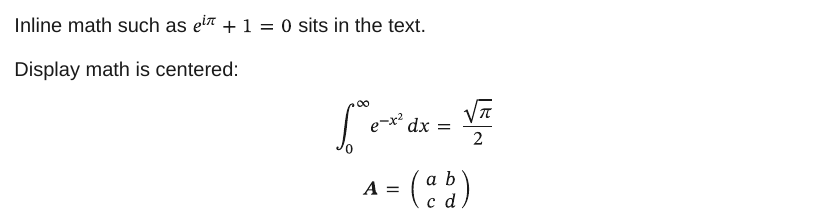

# Math

`$...$` is inline math, `$$...$$` display math. Formulas are rendered to SVG with [ziamath](https://github.com/cdelker/ziamath), so no TeX install is needed.

<div class="ope-example" markdown>
<div markdown>
<p class="ope-label">Markdown</p>

````markdown
--8<-- "examples/math/math.md"
````

</div>
<div markdown>
<p class="ope-label">PDF</p>



</div>
</div>

Display math is centered. A formula takes the colour of the text around it, for example inside a callout. A formula that fails to render is shown as code, and the export prints a warning.
