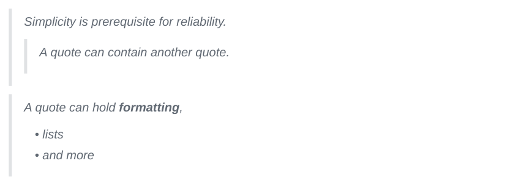

# Block quotes

<div class="ope-example" markdown>
<div markdown>
<p class="ope-label">Markdown</p>

````markdown
--8<-- "examples/blockquotes/blockquotes.md"
````

</div>
<div markdown>
<p class="ope-label">PDF</p>



</div>
</div>

A quote that starts with `[!type]` is a callout, see [Callouts](../obsidian/callouts.md).
