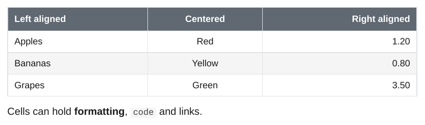
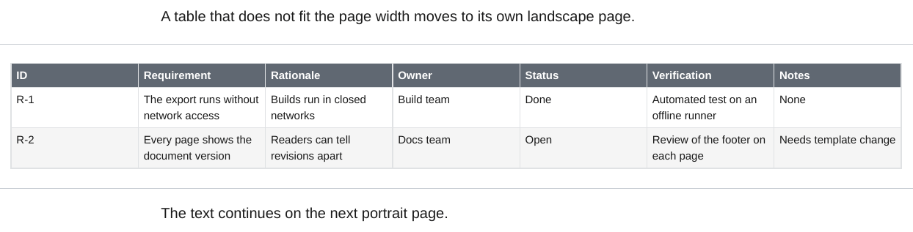

# Tables

## Alignment

Colons in the separator row set the alignment of a column. Cells can hold inline formatting, code and links.

<div class="ope-example" markdown>
<div markdown>
<p class="ope-label">Markdown</p>

````markdown
--8<-- "examples/tables/tables.md"
````

</div>
<div markdown>
<p class="ope-label">PDF</p>



</div>
</div>

## Column widths

Columns are sized by their content, as in Obsidian, also for tables with long source lines. A table with set widths (an HTML `<colgroup>`) keeps their ratio. A very narrow column, such as an image column, is widened to half of an equal share, at most 20%.

Header rows repeat when a table breaks across pages. Rows do not split.

## Wide tables

A table that needs more width than a portrait page has goes to its own landscape page. The text after it continues on a new portrait page.

<div class="ope-example" markdown>
<div markdown>
<p class="ope-label">Markdown</p>

````markdown
--8<-- "examples/wide-tables/wide-tables.md"
````

</div>
<div markdown>
<p class="ope-label">PDF</p>



</div>
</div>

A table goes to landscape when it has at least 6 columns and its content does not fit. The width is estimated from the text: each column counts with its longest cell (up to 25 characters, longer text wraps) or its longest word, which cannot wrap. An image counts as a full cell. A table of short values, such as keys and numbers, stays in the text.

| Option | Effect | Default |
| ------ | ------ | ------- |
| `-O tables.landscape=auto\|on\|off` | `auto` uses the estimate. `on` turns every table with enough columns. `off` keeps all tables portrait. | `auto` |
| `-O tables.landscape_min_cols=N` | Fewest columns for landscape. | `6` |

```bash
ope export ./Notes -O tables.landscape=off
```

A template styles the landscape page with `@page landscape-page`, see [Header and footer](../templating/header-footer.md#landscape-pages).

## Large tables

Pandoc writes a `style` attribute on every cell of a column with an alignment. WeasyPrint 70.0 computes the style of each such cell on its own, which makes the layout of large tables slow. Until a WeasyPrint release includes the fix ([Kozea/WeasyPrint#2981](https://github.com/Kozea/WeasyPrint/pull/2981)), the export applies the same change as a small patch: cells with the same `style` attribute share one computed style. The PDF is the same, only faster. The patch is applied only to WeasyPrint versions known to lack the fix, and only when the WeasyPrint function it wraps looks as expected.

| Option | Effect | Default |
| ------ | ------ | ------- |
| `-O weasyprint.patches=on\|off` | `off` renders with WeasyPrint as installed, without the patch. | `on` |
