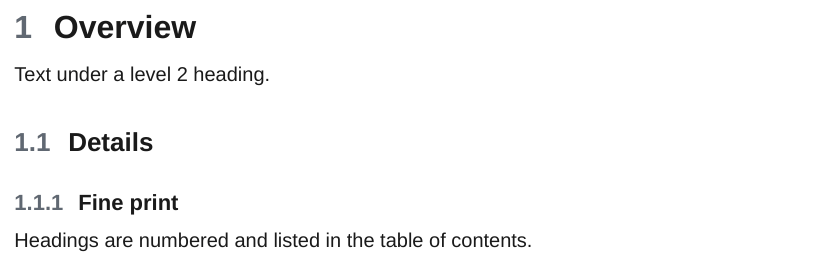
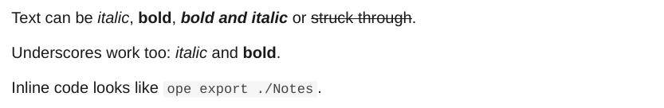
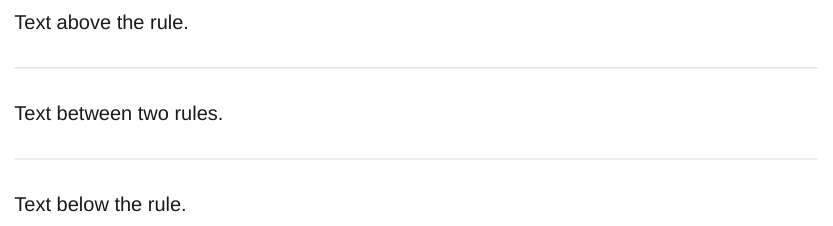

# Headings and text

## Headings

Headings are numbered and go into the table of contents (down to level 4). The headings of a page nest under the page's own heading, so a note's `##` becomes a level below its section. See [Folder structure](../obsidian/structure.md).

<div class="ope-example" markdown>
<div markdown>
<p class="ope-label">Markdown</p>

````markdown
--8<-- "examples/headings/headings.md"
````

</div>
<div markdown>
<p class="ope-label">PDF</p>



</div>
</div>

A page that starts with `###` (it skips a level) is closed up, so section numbers never contain a `0`.

## Emphasis

<div class="ope-example" markdown>
<div markdown>
<p class="ope-label">Markdown</p>

````markdown
--8<-- "examples/emphasis/emphasis.md"
````

</div>
<div markdown>
<p class="ope-label">PDF</p>



</div>
</div>

## Horizontal rules

`---`, `***` and `___` on their own line draw a thin line.

<div class="ope-example" markdown>
<div markdown>
<p class="ope-label">Markdown</p>

````markdown
--8<-- "examples/horizontal-rules/horizontal-rules.md"
````

</div>
<div markdown>
<p class="ope-label">PDF</p>



</div>
</div>

The CSS for all of this is in the [CSS reference](../templating/css-reference.md).
