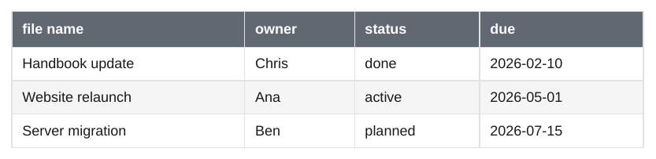

# Bases

[Bases](https://help.obsidian.md/bases) is a core plugin of Obsidian. A base is a `.base` file, or a ` ```base ` code block, in YAML. It selects notes with filters and shows them in views. The export renders a view as it looks when the PDF is made. The notes here are the project notes shown on the [Dataview](../plugins/dataview.md) page.

<div class="ope-example" markdown>
<div markdown>
<p class="ope-label">Markdown</p>

````markdown
--8<-- "examples/bases/bases.md"
````

</div>
<div markdown>
<p class="ope-label">PDF</p>



</div>
</div>

## Views

- `![[Books.base]]` and ` ```base ` blocks show the first view. `![[Books.base#Reading list]]` shows the view with that name.
- `table` and `cards` views become a table, `list` views a bullet list. Other view types (`kanban`, `map`, views of community plugins) become a table, and the export prints a warning.
- Columns come from the view's `order` (only the file name when there is none), with the `displayName` from `properties` as header.
- The file name links to the note when the note is part of the export. Otherwise it is plain text, see [links to pages outside the PDF](wiki-links.md#links-to-pages-outside-the-pdf).
- `sort` (several properties, `ASC` or `DESC`, empty values last), `limit`, `groupBy` (a label line and a table per group), `groupOrder` and the view's `summaries` (a last row such as `Sum: 25.5`) work.
- The global `filters` and the view's `filters` both apply. `and`, `or` and `not` can be nested. `this` is the note that shows the base.

## Expressions

| Area | Supported |
| ---- | --------- |
| Literals | numbers, `"text"` and `'text'`, `true`, `false`, `null`, lists `[1, 2]`, objects, regular expressions `/a.c/gi` |
| Operators | `+ - * / %`, `== != > < >= <=`, `&& \|\| !`, `a ? b : c`, parentheses, `x.y`, `x["y"]`, `list[0]` |
| Properties | `price`, `note.price`, `note["my price"]`, `formula.name`, `file.*`, `this.*`. A name with a `-`, such as `due-date`, is a property when the note has one, otherwise a subtraction. |
| File fields | `name`, `basename`, `path`, `folder`, `ext`, `size`, `ctime`, `mtime`, `properties`, `tags`, `links`, `embeds`, `backlinks` |
| File functions | `hasTag()` (nested tags count), `inFolder()`, `hasLink()`, `hasProperty()`, `asLink()` |
| Global functions | `if()`, `date()`, `duration()`, `now()`, `today()`, `number()`, `list()`, `link()`, `file()`, `min()`, `max()`, `escapeHTML()`, `image()` |
| Any value | `isTruthy()`, `isType()`, `isEmpty()`, `toString()` |
| Text | `length`, `contains()`, `containsAll()`, `containsAny()`, `startsWith()`, `endsWith()`, `lower()`, `title()`, `trim()`, `replace()` (text or regular expression, `$1`), `repeat()`, `reverse()`, `slice()`, `split()` |
| Numbers | `abs()`, `ceil()`, `floor()`, `round()`, `toFixed()` |
| Lists | `length`, `contains()`, `containsAll()`, `containsAny()`, `filter()`, `map()`, `reduce()` (with `value`, `index`, `acc`), `flat()`, `join()`, `reverse()`, `slice()`, `sort()`, `unique()`, `mean()`, `sum()`, `min()`, `max()` |
| Dates | `year`, `month`, `day`, `hour`, `minute`, `second`, `millisecond`, `date()`, `format()` (Moment.js tokens), `time()`, `relative()`, `date + "1M"`, `date - "2h"`, `date - date` (milliseconds) |
| Links | `asFile()`, `linksTo()`, comparing links with files and `this` |
| Objects | `keys()`, `values()` |
| Regular expressions | `matches()` |
| Summaries | `Average`, `Min`, `Max`, `Sum`, `Range`, `Median`, `Stddev`, `Earliest`, `Latest`, `Checked`, `Unchecked`, `Empty`, `Filled`, `Unique`, and custom summaries with `values` |

Anything else, such as `html()`, `icon()`, `random()` or a function that does not exist, is not dropped silently: the export prints a warning that names the base and the expression. A filter that cannot be evaluated is ignored, so the view shows more notes rather than fewer. A column that cannot be evaluated stays empty.

Property types come from the YAML: a date written as `2024-05-01` is a date. The types set in Obsidian (`.obsidian/types.json`) are not read. Dates are shown as `YYYY-MM-DD`, checkboxes as ☑ and ☐.
