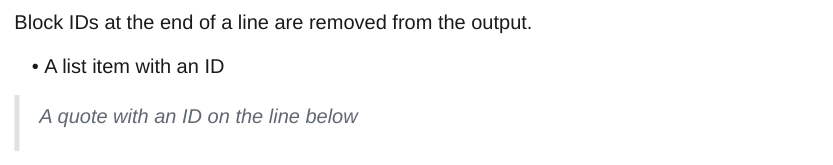

# Block IDs

A block ID (`^id`) at the end of a line marks that paragraph, list item or heading. A line with only `^id` marks the block right above it: a table, list, quote or callout. The IDs are used by [embeds](embeds.md#notes-headings-and-blocks) and removed from the output.

<div class="ope-example" markdown>
<div markdown>
<p class="ope-label">Markdown</p>

````markdown
--8<-- "examples/block-ids/block-ids.md"
````

</div>
<div markdown>
<p class="ope-label">PDF</p>



</div>
</div>

`^id-id` marks the end of a range for [Block Link Plus](../plugins/block-link-plus.md). Without that plugin it is a plain block ID.
