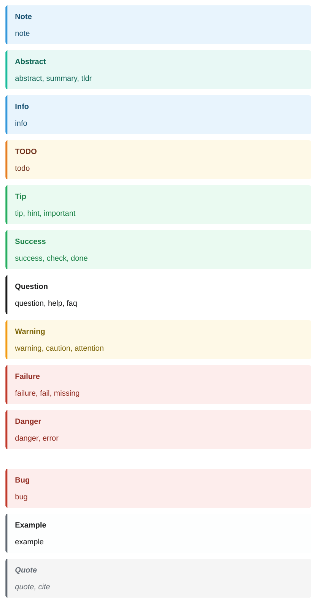

# Callouts

## Types

Every Obsidian callout type works. Aliases share the style of their group: `[!summary]` looks like `[!abstract]`, `[!caution]` like `[!warning]`.

<div class="ope-example" markdown>
<div markdown>
<p class="ope-label">Markdown</p>

````markdown
--8<-- "examples/callout-types/callout-types.md"
````

</div>
<div markdown>
<p class="ope-label">PDF</p>



</div>
</div>

| Group | Types |
| ----- | ----- |
| note | `note` |
| abstract | `abstract`, `summary`, `tldr` |
| info | `info` |
| todo | `todo` |
| tip | `tip`, `hint`, `important` |
| success | `success`, `check`, `done` |
| question | `question`, `help`, `faq` |
| warning | `warning`, `caution`, `attention` |
| failure | `failure`, `fail`, `missing` |
| danger | `danger`, `error` |
| bug | `bug` |
| example | `example` |
| quote | `quote`, `cite` |

Any other type, such as `[!information]`, looks like a note unless the template styles it.

## Titles, folding, nesting

<div class="ope-example" markdown>
<div markdown>
<p class="ope-label">Markdown</p>

````markdown
--8<-- "examples/callouts/callouts.md"
````

</div>
<div markdown>
<p class="ope-label">PDF</p>


</div>
</div>

- The text after the type is the title. Without it, the type name is the title.
- The fold markers `[!faq]+` and `[!faq]-` are accepted. The callout is always shown open.
- Callouts nest with `> >`.
- Blank `>` lines stay inside the callout.
- A line right after a callout without `>` still belongs to it (lazy continuation), as in Obsidian.
- A single-line callout inside other text, for example in a table cell, becomes an inline callout.

## HTML and CSS

A callout becomes a `div` with the classes of its type and group, and a `data-callout` attribute:

```html
<div class="callout callout-warning callout-caution" data-callout="caution">
  <p><span class="callout-title"><strong>Title</strong></span></p>
  <p>Text</p>
</div>
```

An inline callout is a `span` with the same classes. To style a type, see the [CSS reference](../templating/css-reference.md#callouts).
