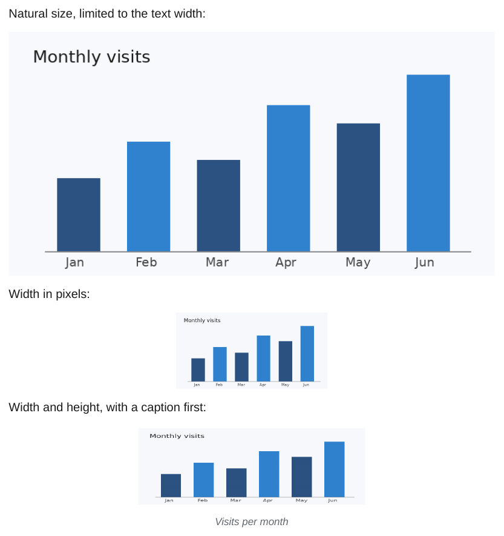
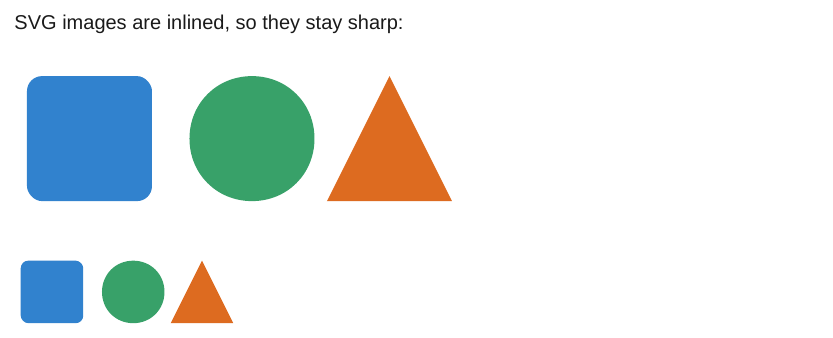
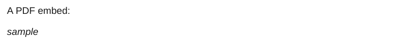
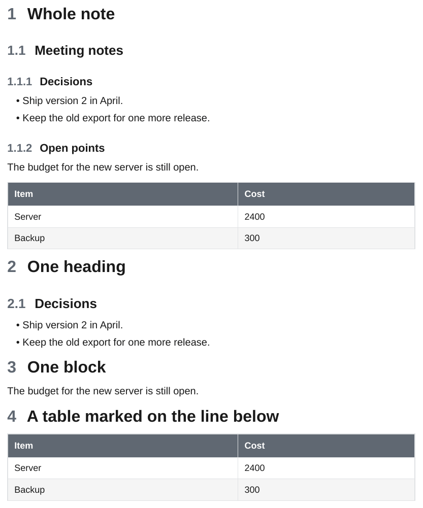

# Embeds

## Images

`![[image.png]]` embeds an image from anywhere in the vault. A number sets the width in pixels, `WIDTHxHEIGHT` both. A caption can come first.

<div class="ope-example" markdown>
<div markdown>
<p class="ope-label">Markdown</p>

````markdown
--8<-- "examples/embed-images/embed-images.md"
````

</div>
<div markdown>
<p class="ope-label">PDF</p>



</div>
</div>

| Syntax | Result |
| ------ | ------ |
| `![[chart.png]]` | Natural size, at most the text width. |
| `![[chart.png\|300]]` | 300 px wide. |
| `![[chart.png\|300x100]]` | 300 by 100 px. |
| `![[chart.png\|Caption\|300]]` | A caption below the image, and a width. |
| `![[missing.png]]` | Shown as _[Image: missing.png]_. |

An image is at most as wide as the text and is never split across pages. PNG, JPG, GIF, WebP and SVG are supported.

## SVG

SVG files are inlined into the HTML, so lines and text stay sharp at any zoom and the text can be searched. draw.io exports get extra handling, see [draw.io](../plugins/drawio.md).

<div class="ope-example" markdown>
<div markdown>
<p class="ope-label">Markdown</p>

````markdown
--8<-- "examples/embed-svg/embed-svg.md"
````

</div>
<div markdown>
<p class="ope-label">PDF</p>



</div>
</div>

## PDF

<div class="ope-example" markdown>
<div markdown>
<p class="ope-label">Markdown</p>

````markdown
--8<-- "examples/embed-pdf/embed-pdf.md"
````

</div>
<div markdown>
<p class="ope-label">PDF</p>



</div>
</div>

A PDF embed is not rendered. It shows as the file name in italics. Export the page as an image to include it.

## Notes, headings and blocks

`![[Note]]` puts the content of another note in place, without its frontmatter. A heading or block reference embeds a part of it. The source note here is `_notes/Meeting notes.md`:

````markdown
--8<-- "examples/_notes/Meeting notes.md"
````

<div class="ope-example" markdown>
<div markdown>
<p class="ope-label">Markdown</p>

````markdown
--8<-- "examples/embed-notes/embed-notes.md"
````

</div>
<div markdown>
<p class="ope-label">PDF</p>



</div>
</div>

| Syntax | Embeds |
| ------ | ------ |
| `![[Note]]` | The whole note. |
| `![[Note#Heading]]` | The heading and its content, up to the next heading of the same or a higher level. |
| `![[Note#A#B]]` | Heading `B` inside section `A`. |
| `![[Note#^id]]` | The block marked `^id`, see [Block IDs](block-ids.md). |
| `![[Note#^id-id]]` | A range, see [Block Link Plus](../plugins/block-link-plus.md). |

Embedded content is processed like the note it comes from:

- Plugin syntax (Dataview, Meta Bind, ...) uses the frontmatter and folder of the source note.
- Images and wiki links resolve from the source note's folder.
- Embeds inside embedded content are expanded too, up to 10 levels. An embed that would include itself again is skipped.
- Headings are shifted so the topmost one sits one level below the heading the embed is under. Without a heading above it, the page title counts. Nested headings keep their relative levels.
- An embed alone on its line (it may be indented, or in a quote or callout) becomes block content. An embed inside other text is inserted inline, with its lines joined.
- A note, heading or block that cannot be found shows as italic text, such as _Note#^id_, and the export prints a warning.

The target is looked up in the whole vault. `![[Note]]` picks the closest note of that name. A path such as `![[Folder/Note#^id]]` is matched against the end of each note's path.
