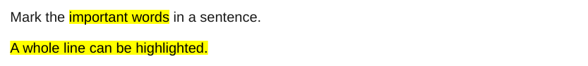
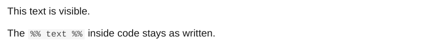

# Highlights and comments

## Highlights

`==text==` becomes `<mark>`.

<div class="ope-example" markdown>
<div markdown>
<p class="ope-label">Markdown</p>

````markdown
--8<-- "examples/highlights/highlights.md"
````

</div>
<div markdown>
<p class="ope-label">PDF</p>



</div>
</div>

## Comments

`%% ... %%` comments, on one line or over several lines, and HTML comments are removed. Inside code they stay as written.

<div class="ope-example" markdown>
<div markdown>
<p class="ope-label">Markdown</p>

````markdown
--8<-- "examples/comments/comments.md"
````

</div>
<div markdown>
<p class="ope-label">PDF</p>



</div>
</div>
