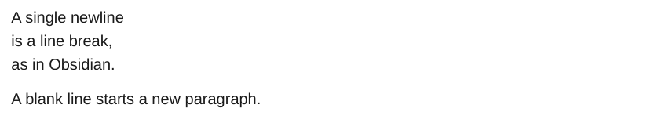

# Line breaks

In Obsidian a single newline is a line break, unless "Strict line breaks" is on. ope reads that setting from `.obsidian/app.json` (`strictLineBreaks`).

<div class="ope-example" markdown>
<div markdown>
<p class="ope-label">Markdown</p>

````markdown
--8<-- "examples/line-breaks/line-breaks.md"
````

</div>
<div markdown>
<p class="ope-label">PDF</p>



</div>
</div>

With strict line breaks, or with `-O line_breaks=soft`, lines of one paragraph are joined:

<div class="ope-example" markdown>
<div markdown>
<p class="ope-label">Markdown</p>

````markdown
--8<-- "examples/line-breaks/line-breaks.md"
````

</div>
<div markdown>
<p class="ope-label">PDF</p>


</div>
</div>

| Option | Effect |
| ------ | ------ |
| `-O line_breaks=hard` | A newline is always a line break. |
| `-O line_breaks=soft` | A newline is a space. A line break needs two trailing spaces or a backslash. |
