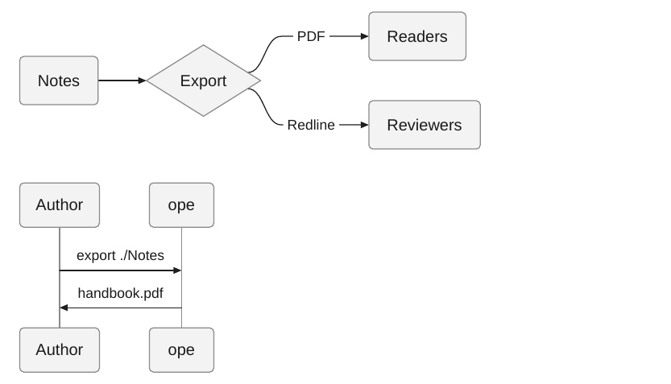
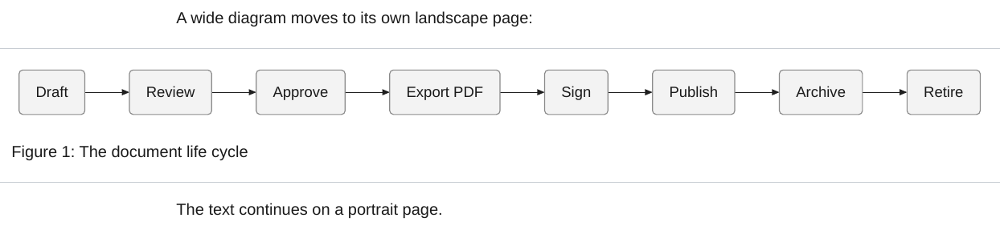
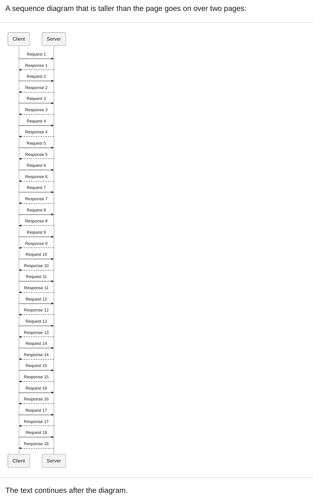

# Mermaid

` ```mermaid ` blocks are drawn as SVG by [Pele](https://pele.run), a Mermaid renderer in TypeScript by the Obsidian team. ope runs it in the JavaScript engine that also runs [DataviewJS](../plugins/dataview.md), so it needs no Node.js, npm or browser. It reads Mermaid 12.1 syntax and draws every diagram type Mermaid has, in a few milliseconds per diagram. A block Pele cannot draw, for example because of a syntax error, stays a code block and the export prints a line starting with `Warning:`.

<div class="ope-example" markdown>
<div markdown>
<p class="ope-label">Markdown</p>

````markdown
--8<-- "examples/mermaid/mermaid.md"
````

</div>
<div markdown>
<p class="ope-label">PDF</p>



</div>
</div>

The output is SVG, so text stays sharp and can be searched.

## Options

| Option | Effect | Default |
| ------ | ------ | ------- |
| `-O mermaid=off` | Keep Mermaid blocks as code. | on |
| `-O mermaid.config=PATH` | JSON [Mermaid config](https://mermaid.js.org/config/schema-docs/config.html), such as `themeVariables.fontSize`. | none |
| `-O mermaid.max_height=LENGTH` | Largest height, such as `10cm`. Taller diagrams are scaled down. | none |
| `-O mermaid.landscape=on\|off` | Put wide diagrams on landscape pages. | `on` |
| `-O mermaid.landscape_ratio=R` | Width to height ratio from which a diagram that has to shrink goes to landscape. | `1.4` |
| `-O mermaid.landscape_min_font=PT` | Smallest text size a diagram may shrink to on a portrait page before it goes to landscape, or to fit a tall diagram on one page. | `7` |
| `-O mermaid.fit=on\|off` | Scale or split diagrams that are taller than the page. | `on` |

A template can set a base config with the `mermaid` key in `template.yaml` or `Template.mermaid_config()`. `mermaid.config` is merged over it.

```bash
ope export ./Notes -O mermaid.config=mermaid.json
```

```json
{ "themeVariables": { "fontSize": "14px", "fontFamily": "Georgia, serif" } }
```

Earlier versions drew diagrams with mermaid-cli, which needed Node.js and a headless Chromium. ope no longer uses it. Its options `mermaid.renderer`, `mermaid.theme`, `mermaid.format`, `mermaid.scale`, `mermaid.cli`, `mermaid.puppeteer_config` and `mermaid.trim` have no effect, and the export prints a warning when one is set. `mermaid.renderer=pele` is accepted without a warning.

## Colors and fonts

Pele draws with its own neutral style. Its colors are the CSS variables listed under [Theming](https://pele.run/theming), such as `--pele-fg`, `--pele-surface`, `--pele-border`, `--pele-line`, `--pele-accent` and `--pele-series-1` to `--pele-series-8`. WeasyPrint does not resolve CSS variables in SVG, so ope writes their values into the SVG. They come from the template's CSS:

- The label font is the `font-family` of `body`, the monospace font the one of `code` or `pre`, and the text color the `color` of `body`. Diagrams use the font of the document.
- `themeVariables.fontFamily` in the Mermaid config sets the label font too.
- `themeVariables.fontSize` in the Mermaid config or in the front matter of a diagram sets the base font size.
- `--pele-*` variables in a rule for `:root`, `html`, `body` or `.pele` set any color. They may use `var()` of other custom properties of those rules.

```css
.pele {
  --pele-surface: #eef2f7;
  --pele-border: #6b7f99;
  --pele-accent: var(--color-accent);
}
```

Pele needs the width of every label to lay a diagram out. ope measures them with Pango, the text engine WeasyPrint uses, in the font of the PDF and at the size they are drawn, so labels fit their boxes in any font. When the template font is not installed, labels are measured and drawn in the font that replaces it. Each label is drawn as one line of shaped text, so Arabic letters join, Arabic and Hebrew read from right to left and Hindi or Thai vowel signs stay on their letters.

A character that no installed font has is drawn as `□` (or `?` when no font has `□` either), and the boxes of the diagram are sized for it. The export prints a warning that lists these characters. Install fonts that cover the scripts of the labels, for example Noto, see [Fonts and scripts](../getting-started/installation.md#fonts-and-scripts).

## Differences from Mermaid

Pele reads the same syntax as Mermaid, but it is not mermaid.js. A diagram can look different from the one in Obsidian:

- Pele has its own layout, so boxes and lines can be placed differently.
- Mermaid themes (`theme`, `themeVariables` colors, `themeCSS`) and `%%{init}%%` theme settings are not used. Map colors with `--pele-*` variables in the template instead, see [Colors and fonts](#colors-and-fonts).
- `layout: elk` is not used. Pele always lays a diagram out on its own.
- Links and images in diagrams are turned off.
- `<br>` and `</br>` both break a label into lines.

The Pele build is part of ope (version 1.6.0, MIT license, see the license header of `obsidian_pdf_exporter/core/assets/pele.js`). `scripts/update_pele.py` in the repository replaces it with another version and checks it against the hash the npm registry publishes. CI checks that the stored build is the pinned one.

## Diagram size

A diagram keeps its natural size and only shrinks when it is wider than the text. `mermaid.max_height` scales down taller ones. Other sizes belong in the template's CSS: every diagram has the classes `doc-image`, `mermaid` and `mermaid-<type>`, see [CSS reference](../templating/css-reference.md#mermaid-diagrams).

Pele gives every diagram an exact size with a margin of 8 px, so there is no empty space to trim.

`%%` comment lines in a block are removed before rendering.

## Wide diagrams

A diagram wider than the text shrinks, and so does its text. When that makes it hard to read, the diagram goes to its own landscape page, like a [wide table](../markdown/tables.md#wide-tables).

<div class="ope-example" markdown>
<div markdown>
<p class="ope-label">Markdown</p>

````markdown
--8<-- "examples/mermaid-landscape/mermaid-landscape.md"
````

</div>
<div markdown>
<p class="ope-label">PDF</p>



</div>
</div>

A diagram moves when it has to shrink to fit a portrait page and either its width is at least `mermaid.landscape_ratio` times its height, or its text would get smaller than `mermaid.landscape_min_font` points. It only moves when the landscape page shows it larger, so a tall diagram stays where it is. On the landscape page it is sized to fit the page height, with room for a caption.

A short paragraph right below the diagram that starts with a word and a number, such as `Figure 1: Overview`, is its caption and moves with it. The diagram gets the class `landscape`, its wrapper `wide-table-section landscape-figure`, so a template's landscape page for tables applies to diagrams too.

```bash
ope export ./Notes -O mermaid.landscape_ratio=2
ope export ./Notes -O mermaid.landscape=off
```

## Tall diagrams

A diagram taller than the page would run past the bottom margin. ope keeps every diagram inside the page content box. The size of the page and its margins come from the template, for portrait and landscape pages alike.

- When the diagram's text stays at least `mermaid.landscape_min_font` points tall, the diagram is scaled down to the height of the page. It keeps its aspect ratio. A caption below it stays on the same page.
- Otherwise the diagram is cut into parts that follow each other over several pages. The parts keep the width the diagram had, so the text keeps its size. Each cut goes through a row near the bottom of the page where little is drawn, so it does not go through a box or a line of text when there is a gap between them.

<div class="ope-example" markdown>
<div markdown>
<p class="ope-label">Markdown</p>

````markdown
--8<-- "examples/mermaid-tall/mermaid-tall.md"
````

</div>
<div markdown>
<p class="ope-label">PDF</p>



</div>
</div>

Every part holds the whole drawing and shows only its band of it, so a search in the PDF also finds the text of the hidden bands. Fitting needs a second layout of the document, which only runs when a diagram is too tall. `-O mermaid.fit=off` turns it off, `mermaid.max_height` gives all diagrams a smaller limit.
