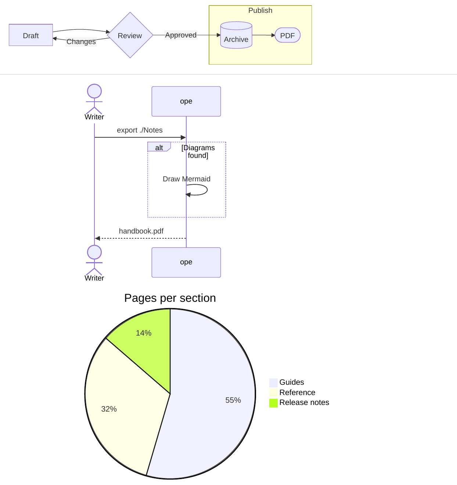
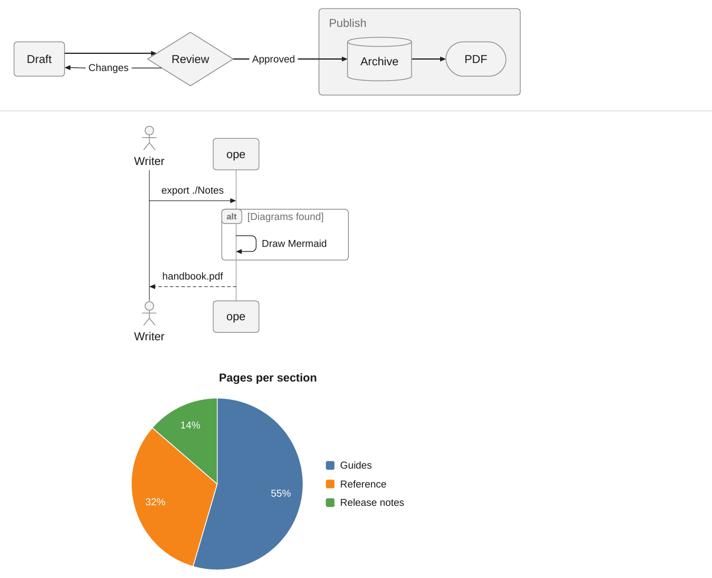

# Mermaid

` ```mermaid ` blocks are drawn with [mermaid-cli](https://github.com/mermaid-js/mermaid-cli). ope uses `mmdc` if it is on the `PATH`, else `npx -y @mermaid-js/mermaid-cli@11.4.2` when Node.js is installed. Without either, the blocks stay code blocks and the export prints a warning. A block that fails to render also stays code. `-O mermaid.renderer=pele` draws the diagrams with [Pele](#renderers) instead, which needs no Node.js.

<div class="ope-example" markdown>
<div markdown>
<p class="ope-label">Markdown</p>

````markdown
--8<-- "examples/mermaid/mermaid.md"
````

</div>
<div markdown>
<p class="ope-label">PDF</p>


</div>
</div>

The default output is SVG, so text stays sharp and can be searched. Mermaid normally puts labels in HTML `<foreignObject>` elements, which WeasyPrint does not draw, so for SVG output ope always sets `htmlLabels: false`. Use PNG for a diagram type that needs HTML labels.

## Options

| Option | Effect | Default |
| ------ | ------ | ------- |
| `-O mermaid=off` | Keep Mermaid blocks as code. | on |
| `-O mermaid.renderer=mermaid-cli\|pele` | What draws the diagrams, see [Renderers](#renderers). | `mermaid-cli` |
| `-O mermaid.format=svg\|png` | Output format. | `svg` |
| `-O mermaid.scale=N` | Pixel density of PNG output. The image keeps its natural size. | `3` |
| `-O mermaid.config=PATH` | JSON [Mermaid config](https://mermaid.js.org/config/schema-docs/config.html) (`theme`, `themeVariables`, ...). | none |
| `-O mermaid.theme=NAME` | Shortcut for `theme`: `default`, `neutral`, `dark`, `forest`, `base`. | none |
| `-O mermaid.cli=COMMAND` | Command that runs mermaid-cli. | auto |
| `-O mermaid.puppeteer_config=PATH` | Puppeteer config passed as `-p`. | none |
| `-O mermaid.trim=on\|off` | Trim the empty space around diagrams. | `on` |
| `-O mermaid.max_height=LENGTH` | Largest height, such as `10cm`. Taller diagrams are scaled down. | none |
| `-O mermaid.landscape=on\|off` | Put wide diagrams on landscape pages. | `on` |
| `-O mermaid.landscape_ratio=R` | Width to height ratio from which a diagram that has to shrink goes to landscape. | `1.4` |
| `-O mermaid.landscape_min_font=PT` | Smallest text size a diagram may shrink to on a portrait page before it goes to landscape, or to fit a tall diagram on one page. | `7` |
| `-O mermaid.fit=on\|off` | Scale or split diagrams that are taller than the page. | `on` |

A template can set a base config with the `mermaid` key in `template.yaml` or `Template.mermaid_config()`. `mermaid.config` is merged over it, then `mermaid.theme`.

```bash
ope export ./Notes -O mermaid.config=mermaid.json
```

```json
{ "theme": "base", "themeVariables": { "primaryColor": "#e8eef5", "pie1": "#2c5282" } }
```

## Renderers

`-O mermaid.renderer` picks what draws the diagrams.

- `mermaid-cli` (default) is Mermaid itself, run by Node.js in a headless Chromium. Diagrams look as they do in Obsidian.
- `pele` is [Pele](https://pele.run), a Mermaid renderer in TypeScript by the Obsidian team. It reads Mermaid 12.1 syntax and draws every diagram type Mermaid has, with its own layout and style. ope runs it in the JavaScript engine that also runs [DataviewJS](../plugins/dataview.md), so it needs no Node.js, npm or browser, and it is much faster: a few milliseconds per diagram instead of seconds for a whole document.

```bash
ope export ./Notes -O mermaid.renderer=pele
```

The same note with both renderers:

<div class="ope-example" markdown>
<div markdown>
<p class="ope-label">mermaid-cli</p>



</div>
<div markdown>
<p class="ope-label">Pele</p>



</div>
</div>

??? example "Markdown of the note"

    ````markdown
    --8<-- "examples/mermaid-renderers/mermaid-renderers.md"
    ````

Pele always writes SVG, so `mermaid.format`, `mermaid.scale`, `mermaid.cli` and `mermaid.puppeteer_config` only apply to mermaid-cli. Its SVG has an exact size with a margin of 8 px, so it needs no trimming pass. Wide and tall diagrams go to landscape pages or are scaled and cut as described below, as with mermaid-cli.

A diagram Pele cannot draw, for example because of a syntax error or syntax it does not know, goes to mermaid-cli when Node.js or `mmdc` is installed. Otherwise it stays a code block and the export prints a line starting with `Warning:`.

### Colors and fonts with Pele

Pele draws with its own neutral style and ignores Mermaid themes (`theme`, `themeVariables`, `themeCSS`). Its colors are the CSS variables listed under [Theming](https://pele.run/theming), such as `--pele-fg`, `--pele-surface`, `--pele-border`, `--pele-line`, `--pele-accent` and `--pele-series-1` to `--pele-series-8`. WeasyPrint does not resolve CSS variables in SVG, so ope writes their values into the SVG. They come from the template's CSS:

- The label font is the `font-family` of `body`, the monospace font the one of `code` or `pre`, and the text color the `color` of `body`. Diagrams use the font of the document.
- `themeVariables.fontFamily` in the Mermaid config sets the label font too.
- `themeVariables.fontSize` in the Mermaid config or in the front matter of a diagram sets the base font size.
- `--pele-*` variables in a rule for `:root`, `html`, `body` or `.pele` set any color. They may use `var()` of other custom properties of those rules.

```css
.pele {
  --pele-surface: #eef2f7;
  --pele-border: #6b7f99;
  --pele-accent: var(--color-accent);
}
```

Pele needs the width of every label to lay a diagram out. ope measures them with Pango, the text engine WeasyPrint uses, in the font of the PDF, so labels fit their boxes in any font.

The Pele build is part of ope (version 1.6.0, MIT license, see the license header of `obsidian_pdf_exporter/core/assets/pele.js`). `scripts/update_pele.py` in the repository replaces it with another version and checks it against the hash the npm registry publishes. Pele's links and images are turned off.

## Diagram size

A diagram keeps its natural size and only shrinks when it is wider than the text. `mermaid.max_height` scales down taller ones. Other sizes belong in the template's CSS: every diagram has the classes `doc-image`, `mermaid` and `mermaid-<type>`, see [CSS reference](../templating/css-reference.md#mermaid-diagrams).

Mermaid leaves empty space around some diagram types. ope trims it to a margin of 8 px. PNG images are cropped. For SVG, mermaid-cli renders a second, transparent PNG of each diagram at its natural size to find the visible area, strokes included, and ope shrinks the `viewBox`. That takes a few seconds, `-O mermaid.trim=off` skips it.

`%%` comment lines in a block are removed before rendering.

## Wide diagrams

A diagram wider than the text shrinks, and so does its text. When that makes it hard to read, the diagram goes to its own landscape page, like a [wide table](../markdown/tables.md#wide-tables).

<div class="ope-example" markdown>
<div markdown>
<p class="ope-label">Markdown</p>

````markdown
--8<-- "examples/mermaid-landscape/mermaid-landscape.md"
````

</div>
<div markdown>
<p class="ope-label">PDF</p>


</div>
</div>

A diagram moves when it has to shrink to fit a portrait page and either its width is at least `mermaid.landscape_ratio` times its height, or its text would get smaller than `mermaid.landscape_min_font` points. It only moves when the landscape page shows it larger, so a tall diagram stays where it is. On the landscape page it is sized to fit the page height, with room for a caption.

A short paragraph right below the diagram that starts with a word and a number, such as `Figure 1: Overview`, is its caption and moves with it. The diagram gets the class `landscape`, its wrapper `wide-table-section landscape-figure`, so a template's landscape page for tables applies to diagrams too.

```bash
ope export ./Notes -O mermaid.landscape_ratio=2
ope export ./Notes -O mermaid.landscape=off
```

## Tall diagrams

A diagram taller than the page would run past the bottom margin. ope keeps every diagram inside the page content box. The size of the page and its margins come from the template, for portrait and landscape pages alike.

- When the diagram's text stays at least `mermaid.landscape_min_font` points tall, the diagram is scaled down to the height of the page. It keeps its aspect ratio. A caption below it stays on the same page.
- Otherwise the diagram is cut into parts that follow each other over several pages. The parts keep the width the diagram had, so the text keeps its size. Each cut goes through a row near the bottom of the page where little is drawn, so it does not go through a box or a line of text when there is a gap between them.

<div class="ope-example" markdown>
<div markdown>
<p class="ope-label">Markdown</p>

````markdown
--8<-- "examples/mermaid-tall/mermaid-tall.md"
````

</div>
<div markdown>
<p class="ope-label">PDF</p>


</div>
</div>

Every part holds the whole drawing and shows only its band of it, so a search in the PDF also finds the text of the hidden bands. PNG diagrams cannot be cut and are always scaled. Fitting needs a second layout of the document, which only runs when a diagram is too tall. `-O mermaid.fit=off` turns it off, `mermaid.max_height` gives all diagrams a smaller limit.

## Notes on mermaid-cli

- WeasyPrint clips text centered in a semi-transparent group. Gantt axis labels are drawn that way, so ope adds `.grid .tick { opacity: 1 }` to the `themeCSS` of SVG diagrams.
- Wrapped labels in timeline diagrams carry a line offset twice. ope removes the outer one, so the text stays in its box.
- Flowchart edge labels use `edgeLabelBackground`. With the `base` theme it can look purple. Set `themeVariables.edgeLabelBackground` to change it.
- When running as root (in a CI container), Chromium needs `--no-sandbox`. ope passes it in that case.
