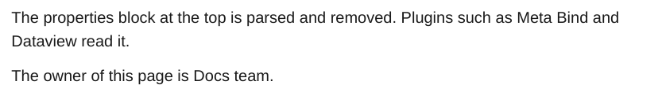

# Properties

The properties block (YAML frontmatter) at the top of a note is parsed and removed from the output. [Meta Bind](../plugins/meta-bind.md) and [Dataview](../plugins/dataview.md) read it.

<div class="ope-example" markdown>
<div markdown>
<p class="ope-label">Markdown</p>

````markdown
--8<-- "examples/properties/properties.md"
````

</div>
<div markdown>
<p class="ope-label">PDF</p>



</div>
</div>

The title of the document comes from `--title` or the folder name, not from a `title` property.
