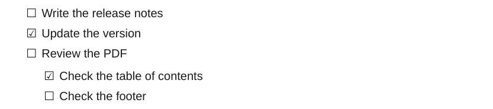

# Tasks

`- [ ]` and `- [x]` become empty and checked boxes on the same line as the text, in a list without bullets.

<div class="ope-example" markdown>
<div markdown>
<p class="ope-label">Markdown</p>

````markdown
--8<-- "examples/tasks/tasks.md"
````

</div>
<div markdown>
<p class="ope-label">PDF</p>



</div>
</div>

The list is a `ul.task-list`. Status characters other than space and `x` (such as `[/]` or `[-]` from some themes) are not drawn as boxes.
