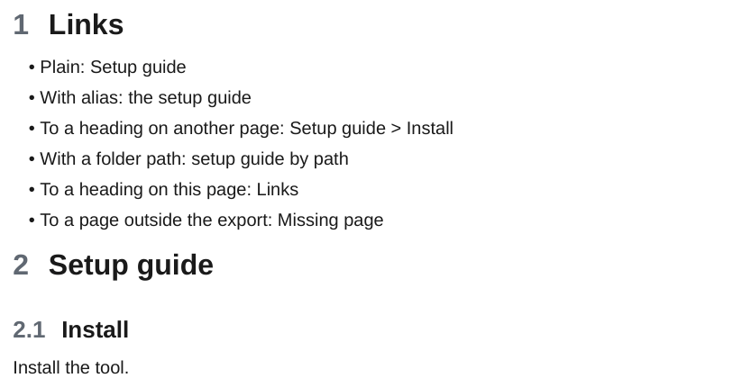

# Wiki links

A wiki link to a page of the export becomes a link to that page's section in the PDF.

<div class="ope-example" markdown>
<div markdown>
<p class="ope-label">Markdown</p>

````markdown
--8<-- "examples/wiki-links/wiki-links.md"
````

</div>
<div markdown>
<p class="ope-label">PDF</p>



</div>
</div>

| Syntax | Result |
| ------ | ------ |
| `[[Page]]` | Link to the section of `Page`. |
| `[[Page\|alias]]` | Same link, showing the alias. |
| `[[#Heading]]`, `[[#Heading\|alias]]` | Link to the heading on the same page. When several pages share a heading name, the one on the linking page wins. When no heading of that name is in the PDF, the label stays as plain text and the export prints a warning. |
| `[[Page#Heading]]`, `[[Page#Heading\|alias]]` | Link to that heading on `Page`. Without an alias the label is `Page > Heading`. When `Page` has no such heading, the link goes to the page. `[[Page#A#B]]` uses the last heading, `B`. |
| `[[Page#^id]]` | Link to the section of `Page`. |
| `[[Folder/Page]]`, `[[Page.md]]` | The last path part is the page name and a `.md` suffix is ignored. When several pages have that name, the one whose path ends with `Folder/Page` wins. |
| `[[Missing page]]`, `[[Missing page#Heading]]` | A page that is not part of the PDF becomes plain text, see [Links to pages outside the PDF](#links-to-pages-outside-the-pdf). |
| `[[https://example.com\|text]]` | An external link. |
| `[text](Page.md)`, `[text](<Folder/My page.md#Heading>)`, `[text](My%20page.md)` | A Markdown link to a note works like the wiki link to the same note. |

When two pages have the same name, the link goes to the one closest to the linking page. Each of them has its own anchor in the PDF (`page`, `page-1`, ...). Links inside code are left as written.

## Links to pages outside the PDF

A link to a note that is not part of the PDF, because it is outside the exported folder or does not exist, cannot be followed in the PDF. It becomes plain text, with no link and no marker: the alias when there is one, else the note name as Obsidian shows it (`Page > Heading` for `[[Page#Heading]]`, `Page > ^id` for a block). The same holds for a link to a heading that is not in the PDF, for the links Dataview and Bases write into their tables and lists, for the link an embed falls back to, and for the text of a redline.

The export prints a warning for each target, once per page, and a count at the end:

```text
  Warning: link to "Release plan#Dates" in Project/Overview.md points outside the PDF, kept as text
  Warning: link to "#old-heading" points outside the PDF, kept as text
  2 links to 2 targets outside the PDF kept as text (see the warnings above)
```

The second form is a link that only turned out to have no target after pandoc, such as a heading that is not in the PDF. To list all of them:

```bash
ope export ./Vault/Handbook 2>&1 | grep "points outside the PDF"
```

| Option | Default | Effect |
| ------ | ------- | ------ |
| `-O links.outside=text\|italic` | `text` | `italic` shows the text of a link to a note outside the PDF in italics, as versions before 0.12 did. |

Standard Markdown links (`[text](https://...)`) are covered in [Links and images](../markdown/links-images.md).
