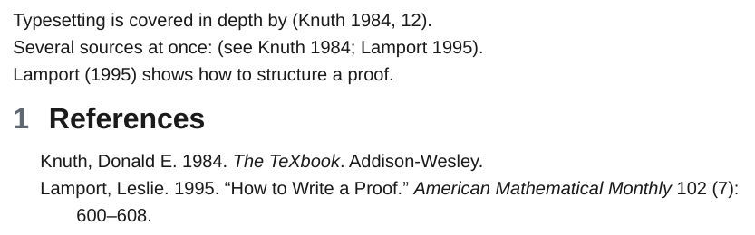

# Citations

The `citations` plugin renders [pandoc citations](https://pandoc.org/MANUAL.html#citation-syntax) with `pandoc --citeproc`, as the [Citations](https://github.com/hans/obsidian-citation-plugin) plugin and the Zotero integration plugins write them. The bibliography of this example is `examples/_attachments/references.bib`.

<div class="ope-example" markdown>
<div markdown>
<p class="ope-label">Markdown</p>

````markdown
--8<-- "examples/citations/citations.md"
````

</div>
<div markdown>
<p class="ope-label">PDF</p>



</div>
</div>

| Written | Rendered (default Chicago author-date style) |
| ------- | -------------------------------------------- |
| `[@doe2020]` | (Doe 2020) |
| `[@doe2020, p. 12]` | (Doe 2020, 12) |
| `[see @doe2020; @roe2021]` | (see Doe 2020; Roe 2021) |
| `[-@doe2020]` | (2020) |
| `@doe2020 shows` | Doe (2020) shows |

## Bibliography

The bibliography is the first one found of:

1. `-O citations.bibliography=refs.bib` (several files separated by `,`). Relative paths start at the current folder or the exported folder.
2. The export path of the Citations plugin: `citationExportPath` in `.obsidian/plugins/obsidian-citation-plugin/data.json`, relative to the vault.
3. `bibliography:` in the frontmatter of the exported notes (a path or a list), relative to the note.

BibLaTeX and BibTeX (`.bib`, `.bibtex`), CSL JSON (`.json`) and CSL YAML (`.yaml`) work.

## Options

| Option | Effect |
| ------ | ------ |
| `-O citations.bibliography=PATH` | Bibliography files, separated by `,`. |
| `-O citations.csl=PATH` | A [CSL style](https://www.zotero.org/styles). `csl:` in the frontmatter does the same. |
| `-O citations.title=TEXT` | Heading of the reference list when ope adds one. |
| `-O citations=off` | Leave citations as written. |

## Where the reference list goes

The list goes into a `::: {#refs}` block when the document has one, otherwise below the last heading named `References`, `Bibliography`, `Works cited`, `Literature` or `Sources`. Without either, a `References` heading and the list are added at the end. Citations link to their entry.

`@word` outside brackets becomes a citation only when `word` is a key of the bibliography, so `@mentions` and e-mail addresses stay text. A link to a literature note such as `[[@doe2020]]` becomes the in-text citation `@doe2020` when the note is not part of the export.

Without a bibliography, citations stay as written and the export prints one warning. A citation whose key is not in the bibliography also prints a warning, and pandoc shows it as `(doe2020?)`.
