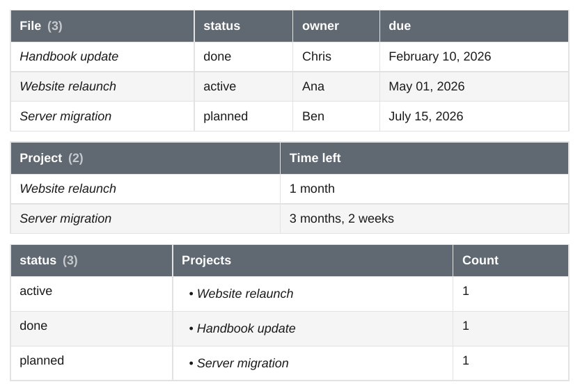
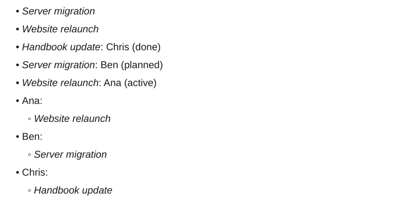
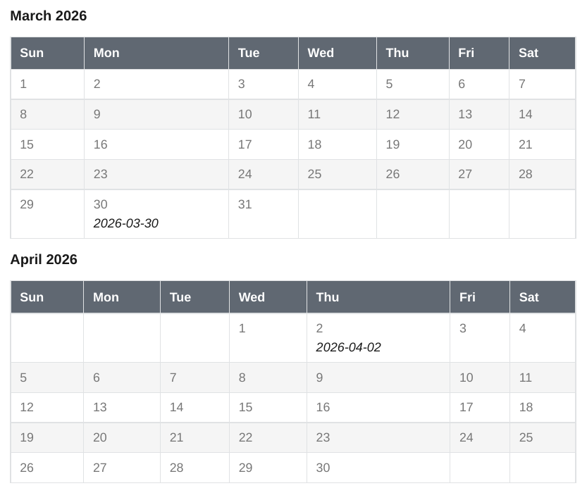
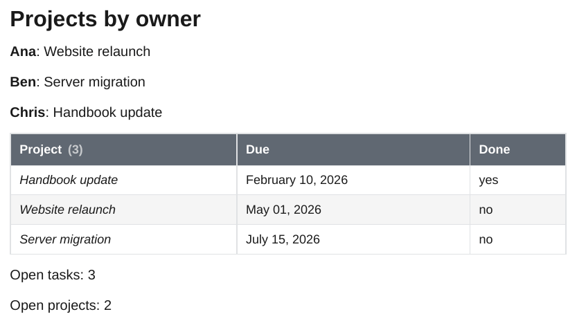

# Dataview

The `dataview` plugin runs [Dataview](https://github.com/blacksmithgu/obsidian-dataview) at export time: ` ```dataview ` blocks, inline queries, inline fields and DataviewJS. The query language, the function library, the page model and the views are a port of the Dataview sources (version 0.5.68), so a query gives the same rows, columns and order as in Obsidian's reading view. The result is written into the page as Markdown, so links to notes that are part of the export become links inside the PDF (other notes are shown in italics, like any unresolved link).

The examples query these notes:

````markdown
--8<-- "examples/_notes/Projects/Website relaunch.md"
````

````markdown
--8<-- "examples/_notes/Journal/2026-03-30.md"
````

The query runs over the whole vault (the folder with `.obsidian`, or the git repository). Without a vault root the blocks stay as they are.

## TABLE

<div class="ope-example" markdown>
<div markdown>
<p class="ope-label">Markdown</p>

````markdown
--8<-- "examples/dataview/dataview.md"
````

</div>
<div markdown>
<p class="ope-label">PDF</p>



</div>
</div>

- `TABLE a, b`, with `AS "Name"` for a column header and `WITHOUT ID` to drop the first column.
- The first header shows the number of results, `File (3)`, as Dataview does. The `File` header is `tableIdColumnName` of the settings; after `GROUP BY` it is the name of the group.
- A list in a cell becomes a bullet list, an empty value shows `renderNullAs` (`-`), dates use `defaultDateFormat` and `defaultDateTimeFormat`, durations read like `3 months, 2 weeks`.
- Text values are Markdown, as in Obsidian: links, emphasis and lists in a property show as such.
- A query with no results shows Dataview's dashed box with "No results to show for table query." (`warnOnEmptyResult`).

## LIST

<div class="ope-example" markdown>
<div markdown>
<p class="ope-label">Markdown</p>

````markdown
--8<-- "examples/dataview-list/dataview-list.md"
````

</div>
<div markdown>
<p class="ope-label">PDF</p>



</div>
</div>

`LIST` shows the file link, `LIST expr` shows `link: value`, and `LIST WITHOUT ID expr` only the value. After `GROUP BY` the group is the first part.

## TASK

<div class="ope-example" markdown>
<div markdown>
<p class="ope-label">Markdown</p>

````markdown
--8<-- "examples/dataview-task/dataview-task.md"
````

</div>
<div markdown>
<p class="ope-label">PDF</p>


</div>
</div>

`TASK` lists the tasks of the selected notes, with their subtasks. A subtask that is also a result is shown once, under its parent. `GROUP BY` puts each group under a heading with its count. Any status other than a space shows a checked box, as in Dataview. The task fields are those of Dataview: `status`, `checked`, `completed`, `fullyCompleted`, `text`, `line`, `section`, `link`, `children`, `parent`, `tags`, `outlinks`, the page fields, and `due`, `completion`, `created`, `start` and `scheduled` from inline fields (`[due:: 2026-04-03]`) or from the emoji of the Tasks plugin (📅 ✅ ➕ 🛫 ⏳).

## CALENDAR

<div class="ope-example" markdown>
<div markdown>
<p class="ope-label">Markdown</p>

````markdown
--8<-- "examples/dataview-calendar/dataview-calendar.md"
````

</div>
<div markdown>
<p class="ope-label">PDF</p>



</div>
</div>

Obsidian shows an interactive calendar of the current month. The PDF shows one month grid (Sunday first) for every month that has results, with the notes under their day.

## Inline queries and inline fields

<div class="ope-example" markdown>
<div markdown>
<p class="ope-label">Markdown</p>

````markdown
--8<-- "examples/dataview-inline/dataview-inline.md"
````

</div>
<div markdown>
<p class="ope-label">PDF</p>


</div>
</div>

- `` `= expr` `` is replaced by the value of the expression, with `this` for the current note. The prefix is `inlineQueryPrefix` of the settings.
- `[key:: value]` shows the key and the value, `(key:: value)` only the value, rendered like reading view does when `prettyRenderInlineFields` is on. A field that fills a whole line, `key:: value`, stays as written.

## DataviewJS

<div class="ope-example" markdown>
<div markdown>
<p class="ope-label">Markdown</p>

````markdown
--8<-- "examples/dataviewjs/dataviewjs.md"
````

</div>
<div markdown>
<p class="ope-label">PDF</p>



</div>
</div>

` ```dataviewjs ` blocks and `` `$= ...` `` inline queries run in an embedded V8 engine ([mini-racer](https://github.com/bpcreech/PyMiniRacer)), so no Node.js is needed. The `dv` object provides:

- data: `dv.pages(source)`, `dv.pagePaths()`, `dv.page()`, `dv.current()`, with Dataview's `DataArray` (`where`, `filter`, `map`, `flatMap`, `sort`, `groupBy`, `groupIn`, `distinct`, `limit`, `slice`, `first`, `last`, `array`, `length`, `values`, `sum`, `avg`, `min`, `max`, and field access like `pages.file.name`),
- queries and expressions: `dv.query()`, `dv.tryQuery()`, `dv.queryMarkdown()`, `dv.execute()`, `dv.evaluate()`, `dv.tryEvaluate()`, `dv.func.*` (the DQL functions),
- output: `dv.table()`, `dv.list()`, `dv.taskList()`, `dv.header()`, `dv.paragraph()`, `dv.span()`, `dv.el()` (with `cls` and `attr`), `dv.container`, `dv.view()`, and `dv.markdownTable()`, `dv.markdownList()`, `dv.markdownTaskList()`,
- values: `dv.date()`, `dv.duration()`, `dv.fileLink()`, `dv.sectionLink()`, `dv.blockLink()`, `dv.parse()`, `dv.literal()`, `dv.compare()`, `dv.equal()`, `dv.array()`, `dv.luxon` (Luxon 3.4) and `dv.io.load()` and `dv.io.csv()` for files of the vault.

The script has no network, no `require`, no Obsidian `app` and no file writes; `dv.io` only reads files inside the vault. Every block has a time limit of 10 seconds (`-O dataview.js-timeout=30` changes it). An error is shown like in Obsidian (`Evaluation Error: ...`) and printed as a `Warning:`. A `dv.header()` is a heading that is not numbered and not in the table of contents.

## Queries

| Part | Supported |
| ---- | --------- |
| Query types | `TABLE` (`WITHOUT ID`, `AS`), `LIST` (`LIST expr`, `WITHOUT ID`), `TASK`, `CALENDAR` |
| Data commands | `WHERE`, `SORT` (several keys, `ASC`/`DESC`), `GROUP BY` (with `rows`), `FLATTEN`, `LIMIT`, in any order and repeated; `//` comments |
| Sources | `#tag` (nested tags count), `"folder"` or `"folder/note"`, `[[note]]` (notes that link to it), `outgoing([[note]])`, `csv("file.csv")`, combined with `and`, `or`, `-` or `!` and parentheses |
| Literals | numbers, `"text"`, `true`, `false`, `null`, `[lists]`, `{objects}`, `[[links]]`, `![[embeds]]`, `date(2026-04-01)`, `date(today)`, `date(now)`, `date(sow)` and the other shorthands, `dur(1 week 2 days)` |
| Operators | `+ - * / %`, `= != < > <= >=`, `and`, `or`, `!`, `a.b`, `a["b"]`, `list[0]`, `(x) => expr`, `row.field`, `this.field`, `[[note]].field` |
| Functions | all of Dataview's: `object`, `list`, `date`, `dur`, `number`, `string`, `link`, `embed`, `elink`, `typeof`, `round`, `trunc`, `floor`, `ceil`, `min`, `max`, `sum`, `product`, `average`, `minby`, `maxby`, `contains`, `icontains`, `econtains`, `containsword`, `extract`, `sort`, `reverse`, `length`, `nonnull`, `firstvalue`, `all`, `any`, `none`, `join`, `filter`, `map`, `flat`, `slice`, `unique`, `reduce`, `regextest`, `regexmatch`, `regexreplace`, `replace`, `lower`, `upper`, `split`, `startswith`, `endswith`, `padleft`, `padright`, `substring`, `truncate`, `default`, `ldefault`, `display`, `choice`, `striptime`, `dateformat`, `durationformat`, `currencyformat`, `localtime`, `hash`, `meta` |

Values follow Dataview: functions work on each element of a list where Dataview does, comparisons of mixed types order by type, `null` sorts first, text sorts like `localeCompare`, dates and durations follow Luxon (a month is 30 days, `date - date` is normalised into years, months, weeks, days and time). A row whose expression fails is left out; when every row fails, the query shows Dataview's error text. A query that does not parse shows the parser error, and the export prints a `Warning:`.

## Pages

Every note has the `file` fields of Dataview: `name`, `folder`, `path`, `ext`, `link`, `size`, `ctime`, `cday`, `mtime`, `mday`, `tags` (with parent tags), `etags`, `inlinks`, `outlinks`, `aliases`, `lists`, `tasks`, `frontmatter`, `day` (from a `date` field or a date in the file name) and `starred` (from `.obsidian/bookmarks.json`).

Frontmatter properties are fields, with a normalised key next to the written one (`Due Date` is also `due-date`). Text that is a date, a duration or a link becomes one. Inline fields (`key:: value`, `[key:: value]`, `(key:: value)`) in paragraphs, headings and list items are fields too, with values parsed as numbers, dates, durations, links, booleans and lists.

`ctime` and `mtime` come from the file system, as for [Bases](../obsidian/bases.md). After a git checkout they are the checkout time, not the commit time.

The order of results without `SORT` is the order of the vault tree, folder by folder and case-insensitive (Obsidian uses the order it indexed the files in).

## Settings

The settings of the Dataview plugin are read from `.obsidian/plugins/dataview/data.json`: `renderNullAs`, `defaultDateFormat`, `defaultDateTimeFormat`, `tableIdColumnName`, `showResultCount`, `warnOnEmptyResult`, `maxRecursiveRenderDepth`, `inlineQueryPrefix`, `inlineJsQueryPrefix`, `enableInlineDataview`, `enableDataviewJs`, `enableInlineDataviewJs`, `prettyRenderInlineFields` and `dataviewJsKeyword`. Without the file the defaults of Dataview apply, except that DataviewJS is on. Each setting can be changed for one export:

```bash
ope export ./Vault -O dataview.renderNullAs=n/a -O dataview.enableDataviewJs=false
```

`-O dataview.now=2026-04-01T09:00` fixes `date(now)` and `date(today)`, so a PDF can be made again with the same content.

## Differences to Obsidian

- Interactive parts have no PDF form: tasks cannot be checked and the calendar is a static grid.
- Names of months and days are English (`en-US`), whatever the language of the system.
- `dv.func` functions get values, not JavaScript functions (`dv.func.map(list, x => ...)` does not work; use the `DataArray` methods). `dv.el()` elements support the common DOM methods but have no real browser behind them.
- An embed in a cell (`![[note]]`) is shown as a link; images are shown.
- `inlineQueriesInCodeblocks`: inline queries in fenced code blocks are not evaluated.
