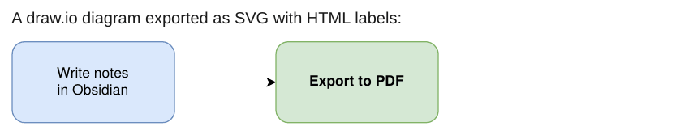

# draw.io

draw.io stores labels as HTML in `<foreignObject>`, which WeasyPrint does not draw. Next to each label it writes a short fallback text and a "Text is not SVG - cannot display" note. The `drawio` plugin replaces each label with SVG text, one `<tspan>` per line, and removes the note.

<div class="ope-example" markdown>
<div markdown>
<p class="ope-label">Markdown</p>

````markdown
--8<-- "examples/drawio/drawio.md"
````

</div>
<div markdown>
<p class="ope-label">PDF</p>



</div>
</div>

This is a best effort:

- Mixed formatting inside one label (a bold word, a second colour) is flattened to the main style of the label.
- Wrapped labels are wrapped again with an estimated character width, so line breaks can differ a little from draw.io.
- For full fidelity, export from draw.io with "Convert labels to SVG" turned on, or as PNG.
