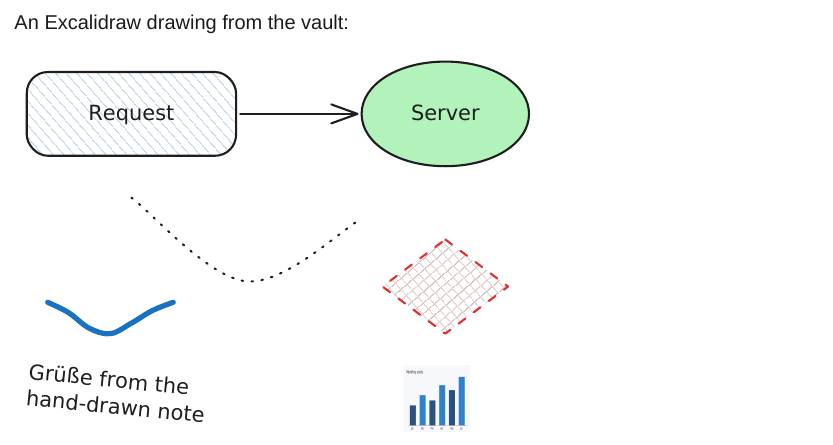

# Excalidraw

The `excalidraw` plugin turns embeds of [Excalidraw](https://github.com/zsviczian/obsidian-excalidraw-plugin) drawings into images.

<div class="ope-example" markdown>
<div markdown>
<p class="ope-label">Markdown</p>

````markdown
--8<-- "examples/excalidraw/excalidraw.md"
````

</div>
<div markdown>
<p class="ope-label">PDF</p>



</div>
</div>

## Embeds

| Syntax | Finds |
| ------ | ----- |
| `![[Drawing.excalidraw]]`, `![[Drawing.excalidraw.md]]` | The drawing note `Drawing.excalidraw.md`. |
| `![[Drawing]]` | Any note with `excalidraw-plugin` in its frontmatter. |
| `![[Sketch.excalidraw]]` | A plain `.excalidraw` JSON file, as saved by excalidraw.com. |
| `![[Drawing.excalidraw\|400]]` | A width, as for images. |

## Auto-export files first

When the plugin's "Auto-export SVG" or "Auto-export PNG" setting wrote `Drawing.excalidraw.svg` (or `.light.svg`, `.png`, `.light.png`) next to the drawing, that file is used as it is. It looks exactly like the drawing in Obsidian. `-O excalidraw.auto_export=off` turns this off.

## Drawn from the scene

Otherwise ope reads the scene from the `## Drawing` section of the note (a ` ```json ` block, or ` ```compressed-json ` in LZ-String base64) and draws it as SVG. Excalidraw's hand-drawn look comes from rough.js in the browser. ope draws the same shapes with clean strokes, so the export needs neither Node.js nor a browser.

| Drawn | Not drawn (with a warning) |
| ----- | -------------------------- |
| Rectangles (also rounded), diamonds, ellipses | Embedded web pages, shown as an outlined box with their link |
| Solid fills; hachure, cross-hatch and zigzag fills as straight hatching | LaTeX equations |
| Lines, curves, elbow arrows and all arrowheads | Embedded notes, PDFs and drawings inside a drawing |
| Free drawing, as a line of even width | Image cropping (the whole image is drawn) |
| Text, also inside shapes and on arrows | Element links and `#^group=`, `#^area=`, `#^frame=` parts of an embed (the whole drawing is shown) |
| Images from the vault or a data URL, mirrored images | |
| Stroke colour, width, dashed and dotted strokes, opacity, rotation | |

Frames are not drawn, as in an Excalidraw export. Text uses the Excalidraw fonts when they are installed and falls back to a sans-serif or monospace font. The frontmatter keys `excalidraw-export-transparent` and `excalidraw-export-padding` are honoured. Dark drawings are drawn with their light colours.

For an exact copy of the hand-drawn look, turn on auto-export in the Excalidraw plugin.
