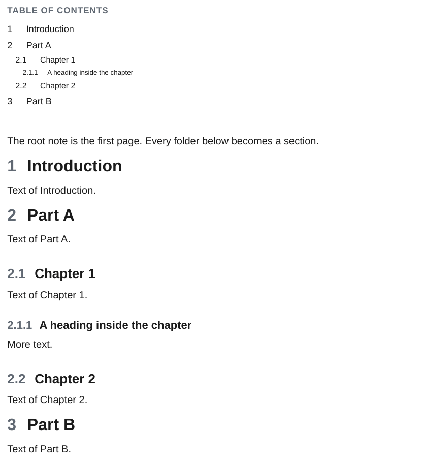

# Folder Notes

`ope export ROOT` walks the folder `ROOT`. Every subfolder becomes a section. The [Folder Notes](https://github.com/LostPaul/obsidian-folder-notes) plugin stores the note of a folder inside it, with the folder's name: `Chapter A/Chapter A.md`. The `folder_notes` plugin maps that note onto its folder while the page tree is built, so the note becomes the text of the folder's section. The root note `ROOT/ROOT.md` is the first text of the document.

<div class="ope-example" markdown>
<div markdown>
<p class="ope-label">Folder</p>

```text
folder-notes/
├── folder-notes.md       ← root note
├── Introduction/
│   └── Introduction.md   ← section 1
├── Part A/
│   ├── Part A.md         ← section 2
│   ├── Chapter 1/
│   │   └── Chapter 1.md  ← section 2.1
│   └── Chapter 2/
│       └── Chapter 2.md  ← section 2.2
└── Part B/
    └── Part B.md         ← section 3
```

</div>
<div markdown>
<p class="ope-label">PDF</p>



</div>
</div>

## Without the plugin

With `--disable-plugin folder_notes` the folders still become numbered sections, with the folder name as heading, but the sections have no text: `Folder/Folder.md` is not used.

## Sections, table of contents and numbering

- Sections are sorted by folder name. The folder name is the section heading.
- Headings are numbered and listed in the table of contents. `--no-toc` leaves out the table of contents.
- Headings inside a note nest under the section heading, so a note's `##` sits one level below its folder.
- `--include` and `--exclude` pick top-level subfolders by name.
- Folders without Markdown, such as attachment folders, are left out. `.git`, `.obsidian`, `.vscode` and every other dot folder are skipped.

## The root note

Three layouts are recognised:

1. `Handbook/Handbook.md` exists: it is the root note.
2. `Handbook/Handbook/Handbook.md` exists: the inner folder is the root, its siblings become sections.
3. Neither: the root has no text, the subfolders are the sections.

## The vault

Links, embeds and images are looked up in the whole vault, not only in the exported folder. The vault is the folder that holds `.obsidian`, or else the root of the git repository. When several files share a name, the one closest to the linking page wins: `Part A/img/logo.png` beats `images/logo.png` for every page inside `Part A/`.

## Other conventions

A third-party plugin can change the convention with the `find_folder_note` hook, for example to use `Folder/README.md` or the note with `folder-note: true` in its frontmatter. See [Write a plugin](write-a-plugin.md#hooks).
