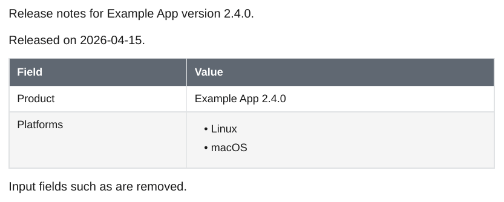

# Meta Bind

The `meta_bind` plugin fills [Meta Bind](https://github.com/mProjectsCode/obsidian-meta-bind-plugin) `VIEW` fields with the values of the page's frontmatter. `INPUT` and `BUTTON` fields have no PDF form and are removed.

<div class="ope-example" markdown>
<div markdown>
<p class="ope-label">Markdown</p>

````markdown
--8<-- "examples/meta-bind/meta-bind.md"
````

</div>
<div markdown>
<p class="ope-label">PDF</p>



</div>
</div>

- `{key}` is the value of a frontmatter field. `+` joins values and quoted text.
- A multi-line value shown inside text, such as in a table cell, stays in its cell: list items become an HTML list, other lines are joined with line breaks. A field alone on its line keeps the lines as they are.
- Fields inside code blocks are left as written.
- In an embedded note, the fields use the embedded note's frontmatter.

!!! warning "Date formats"
    `VIEW[{date}][date(...)]` is meant to format a date with moment.js tokens. The format is currently lowercased, so the result is wrong ([#61](https://github.com/Spenhouet/obsidian-pdf-exporter/issues/61)). Use `[text]` to show the value as written.
