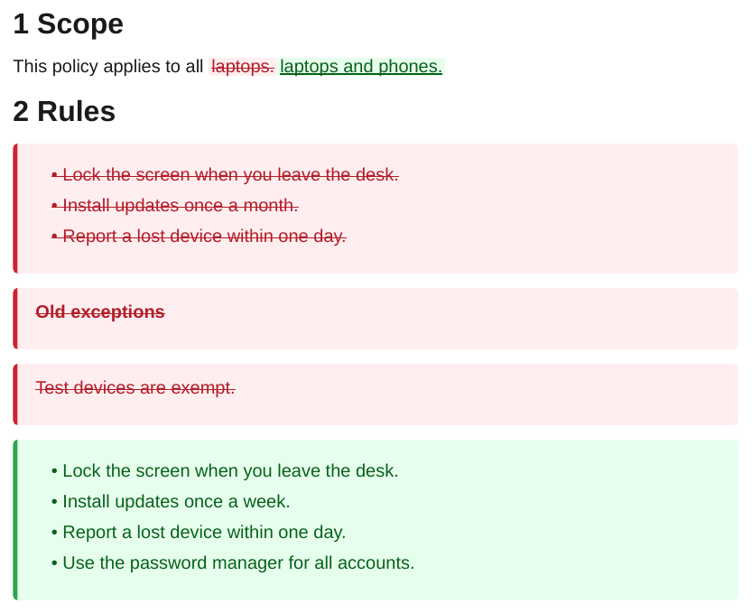

# Redline

`ope redline` builds a PDF that shows what changed in a folder between two git commits: inserted text in green, removed text in red and struck through. It is meant for reviews, approvals and audits of documents kept in git.

```bash
cd MyVault                     # must run inside the git repository
ope redline ./Handbook --from-commit v3.0.0 --to-commit HEAD
```

The PDF is written to `./.export/<title>_redline.pdf`. All options are in the [CLI reference](reference/cli.md#redline).

## Example

<div class="ope-example" markdown>
<div markdown>
<p class="ope-label">Before (commit 1)</p>

````markdown
--8<-- "examples/_redline/before.md"
````

<p class="ope-label">After (commit 2)</p>

````markdown
--8<-- "examples/_redline/after.md"
````

</div>
<div markdown>
<p class="ope-label">PDF</p>



</div>
</div>

## How changes are shown

- A block that changed a little (similar enough to the old one) shows word-level changes inline, as `<ins>` and `<del>`.
- A block that is new, or changed so much that the old and new text have little in common, is shown as a removed block followed by an inserted block (`.redline-del` and `.redline-ins`).
- Removed headings are shown as bold text, so they do not go into the table of contents or the numbering.
- Both commits are exported with the same steps and plugins, so embeds, Dataview tables and Meta Bind values are compared as they appear in the PDF.

The subtitle and the version label show the two short hashes, such as `Redline: 1a2b3c4 -> 5d6e7f8`. `--subtitle` replaces the subtitle.

## Template

`redline` uses the built-in `redline` template. It looks like `default` and adds the styles for the changes. A custom template for redlines styles these selectors:

| Selector | Marks |
| -------- | ----- |
| `ins`, `del` | Word-level insertions and removals. |
| `.redline-ins`, `.redline-del` | Inserted and removed blocks. |

See the [CSS reference](templating/css-reference.md#redline).

## In CI

The checkout needs the history of both commits:

```yaml
- uses: actions/checkout@v4
  with:
    fetch-depth: 0
- run: ope redline ./Handbook --from-commit "${{ github.event.pull_request.base.sha }}" -o redline.pdf
```
