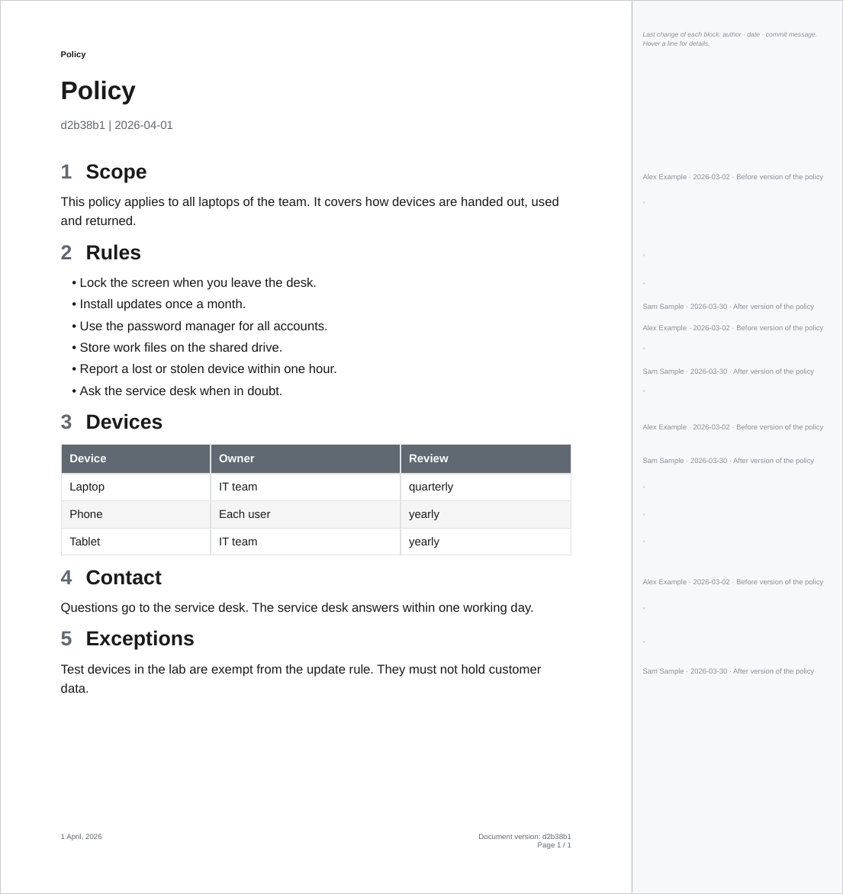
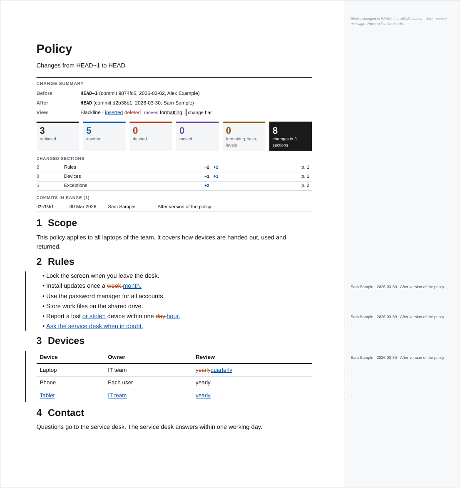

# Blame

`--blame` adds a strip to the right of every page that says, for each block of the page, who changed it last, when and why:

```text
Sam Sample · 2026-03-30 · Revise the review procedure and move the training text
```

```bash
ope export ./Policy --blame                              # every block of the current version
ope redline ./Policy --from-commit v1.0.0 --blame        # the blocks changed since v1.0.0
```

The page itself is exactly the page of the same command without `--blame`: same size, margins, layout and page breaks, with links and bookmarks. The strip is added outside of it, so the PDF page gets wider and the edge of the document page stays visible. It works with every template, also with your own.



## What the strip shows

- One line of text per block (paragraph, list item, table row, heading, code block, figure), at the height of the first line of the block: the author's name, the date of the commit (`YYYY-MM-DD`) and the first line of the commit message. A line that is too long for the strip is cut with "…".
- In an export, every block gets a line. A block that comes from the same commit as the block above it shows a faint ″ (ditto) instead of repeating the line.
- In a redline, only the blocks that changed between the two versions get a line, in a darker grey. That is the blame of the newer version, limited to the commits between `--from-commit` and `--to-commit`. Removed blocks have no line: they are not in the newer version.
- A short key at the top of the first strip says what the lines mean.



## Details on hover

Each line carries the full details of its commit: the author's name and email, the date and time with the time zone, the full commit hash and the full commit message. They show as a tooltip when the pointer rests on the line, in viewers that show tooltips of PDF form fields:

| Viewer | Tooltip |
| ------ | ------- |
| Firefox and other viewers built on pdf.js | Yes (tested) |
| Adobe Acrobat and Acrobat Reader | Yes (field tooltips per the PDF specification, not tested here) |
| Okular | Likely (shows field tooltips, not tested here) |
| Chrome and Edge built-in viewer | No tooltip seen |
| macOS Preview, Evince | No |

The tooltip is the alternate name (`/TU`) of an invisible, read-only push button over each line. It draws nothing and prints nothing. The PDF therefore contains form fields, and some viewers mention that when they open it. Viewers without tooltips still show the line itself.

## How blocks are matched to commits

The HTML of the PDF does not know which line of a note it came from, because steps and plugins rewrite the Markdown (links, embeds, callouts, Meta Bind fields). `--blame` therefore matches by text:

1. Every Markdown file in the exported folder is read with `git blame` (the working tree for an export, the `--to-commit` for a redline). Each source line is reduced to its words, without markup.
2. Each block of the rendered document is matched to the source lines that share most of its word triplets. A paragraph that spans several source lines is matched to all of them.
3. The block gets the newest commit of its matched lines.
4. A block that matches nothing gets no line. A block without a match between two blocks of the same commit belongs to that commit.

The log of the command shows how many blocks matched, for example `Blame: 97% of the blocks matched a source line`.

## Limits

- Values that come from elsewhere do not show their commit. A Meta Bind value shows the commit of the line that holds the field, not the commit that changed the property; a Dataview table shows the commit of the query, not of the notes it reads.
- Embedded notes from outside the exported folder are not blamed, so their blocks have no line.
- Text that occurs in several notes is matched to the note that explains most of it.
- Lines that are not committed yet are shown as "Not committed yet" in an export.
- `--blame` needs the git history of both versions, so it is not available with [`--from-path`](compare.md#without-git).
- The strip adds its lines, the hover buttons and, for the key line, an italic font to the PDF. The rest is written exactly as without `--blame`, with the same fonts and the same compression. A 50-page document of text grows by about 4 %.
