# What changes look like

Each case below shows the note in the older commit, the note in the newer commit and the redline PDF made from the two with the built-in `redline` template. The examples live in [`examples/_redline/`](https://github.com/Spenhouet/obsidian-pdf-exporter/tree/main/examples/_redline), and `scripts/render_redline_examples.py` makes the pictures from them in a temporary git repository.

The pictures show the current design of the `redline` template, which is being reworked; the marks and boxes may look different after that.

Some cases do not come out well yet. They are marked below with a warning and a link to the issue. The pictures show the current behaviour, not the intended one.

## Summary

| Change | Shown as | Status |
| ------ | -------- | ------ |
| Words inside a paragraph | Inline `<del>` and `<ins>` | Good |
| Paragraph inserted or removed | Green or red block | Good |
| Paragraph changed and a new one right after it | Whole block removed and inserted | [#89](https://github.com/Spenhouet/obsidian-pdf-exporter/issues/89) |
| Paragraph replaced by a different one | Word-level mix | [#82](https://github.com/Spenhouet/obsidian-pdf-exporter/issues/82) |
| Heading text | Inline marks, also in the table of contents | Good |
| Heading inserted or removed | Green block, or red bold text outside the table of contents | Good |
| Heading level | Not shown | [#86](https://github.com/Spenhouet/obsidian-pdf-exporter/issues/86) |
| List item changed, inserted or removed, also nested | Inline marks per item | Good, see [#89](https://github.com/Spenhouet/obsidian-pdf-exporter/issues/89) for neighbouring changes |
| Table cell | Inline marks in the cell | Good |
| Table row inserted or removed, column width changed | The table breaks | [#80](https://github.com/Spenhouet/obsidian-pdf-exporter/issues/80) |
| Callout text | Inline marks in the callout | Good |
| Callout inserted or removed | Title and body in separate boxes | [#83](https://github.com/Spenhouet/obsidian-pdf-exporter/issues/83) |
| Image replaced | Both images, unmarked | [#84](https://github.com/Spenhouet/obsidian-pdf-exporter/issues/84) |
| Embedded note changed | Inline marks in the embedded text | Good |
| Moved paragraph | Removed at the old place, inserted at the new one | Good |
| Code block, Mermaid diagram | `<del>` and `<ins>` as literal text | [#81](https://github.com/Spenhouet/obsidian-pdf-exporter/issues/81) |
| Meta Bind value | Inline marks | Good |
| Property that is not shown in the text | Not shown | By design |
| Dataview result | Inline marks in the cells; a new or removed row breaks the table | [#80](https://github.com/Spenhouet/obsidian-pdf-exporter/issues/80) |
| Task checked | Brackets as text | [#85](https://github.com/Spenhouet/obsidian-pdf-exporter/issues/85) |
| Footnote text | Marks in the footnote area, plus empty boxes | [#87](https://github.com/Spenhouet/obsidian-pdf-exporter/issues/87) |

## Text

### Words inside a paragraph

Inserted words are green and underlined, removed words red and struck through. A replaced word is shown as the old word followed by the new one. Words are split at spaces, so a full stop or comma belongs to the word before it and is replaced together with it.

<div class="ope-example ope-redline" markdown>
<div markdown>
<p class="ope-label">Before</p>

````markdown
--8<-- "examples/_redline/words/before/Policy/Policy.md"
````

</div>
<div markdown>
<p class="ope-label">After</p>

````markdown
--8<-- "examples/_redline/words/after/Policy/Policy.md"
````

</div>
<div markdown class="ope-redline-pdf">
<p class="ope-label">Redline PDF</p>

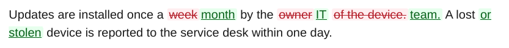

</div>
</div>

### Inserted and removed paragraphs

A paragraph that is only in one version is a block of its own: green with a bar for inserted, red and struck through for removed.

<div class="ope-example ope-redline" markdown>
<div markdown>
<p class="ope-label">Before</p>

````markdown
--8<-- "examples/_redline/blocks/before/Policy/Policy.md"
````

</div>
<div markdown>
<p class="ope-label">After</p>

````markdown
--8<-- "examples/_redline/blocks/after/Policy/Policy.md"
````

</div>
<div markdown class="ope-redline-pdf">
<p class="ope-label">Redline PDF</p>


</div>
</div>

### Moved text

There is no separate mark for moved text. A paragraph that moved is removed at its old place and inserted at its new place, so the reader sees both.

<div class="ope-example ope-redline" markdown>
<div markdown>
<p class="ope-label">Before</p>

````markdown
--8<-- "examples/_redline/moved/before/Policy/Policy.md"
````

</div>
<div markdown>
<p class="ope-label">After</p>

````markdown
--8<-- "examples/_redline/moved/after/Policy/Policy.md"
````

</div>
<div markdown class="ope-redline-pdf">
<p class="ope-label">Redline PDF</p>

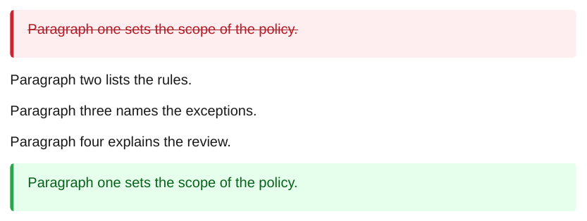

</div>
</div>

### Replaced paragraphs

!!! warning "Known issue #82"
    A paragraph that is replaced by a different one at the same place is word-diffed even when the two have little in common. The result is a mix of removed and inserted words that is hard to read. The same happens when two neighbouring paragraphs swap places. See [#82](https://github.com/Spenhouet/obsidian-pdf-exporter/issues/82).

    When a changed paragraph is directly followed or preceded by an inserted or removed one, the changed paragraph is shown as a whole removed and inserted block instead of word by word. See [#89](https://github.com/Spenhouet/obsidian-pdf-exporter/issues/89).

<div class="ope-example ope-redline" markdown>
<div markdown>
<p class="ope-label">Before</p>

````markdown
--8<-- "examples/_redline/replaced/before/Policy/Policy.md"
````

</div>
<div markdown>
<p class="ope-label">After</p>

````markdown
--8<-- "examples/_redline/replaced/after/Policy/Policy.md"
````

</div>
<div markdown class="ope-redline-pdf">
<p class="ope-label">Redline PDF</p>

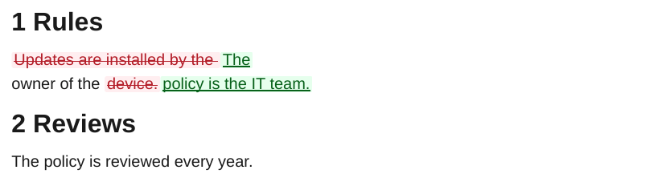

</div>
</div>

## Headings

### Changed, inserted and removed headings

A changed heading keeps its place and number and shows the word changes, also in the table of contents. An inserted heading is a green block and gets a number. A removed heading is turned into bold text inside the red block, so it gets no number, does not shift the numbering of the following sections and does not show up in the table of contents.

<div class="ope-example ope-redline" markdown>
<div markdown>
<p class="ope-label">Before</p>

````markdown
--8<-- "examples/_redline/headings/before/Policy/Policy.md"
````

</div>
<div markdown>
<p class="ope-label">After</p>

````markdown
--8<-- "examples/_redline/headings/after/Policy/Policy.md"
````

</div>
<div markdown class="ope-redline-pdf">
<p class="ope-label">Redline PDF</p>

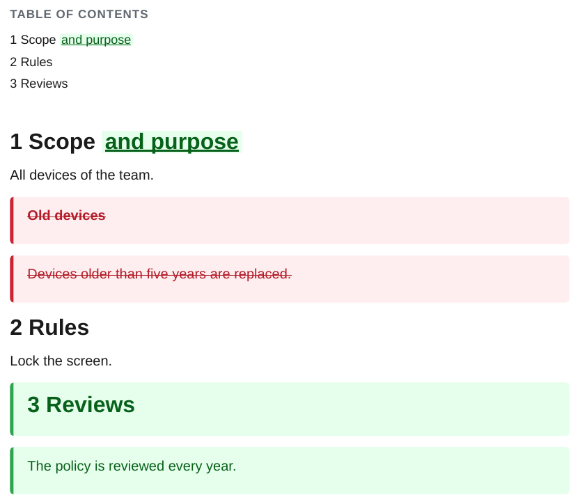

</div>
</div>

### Heading level

!!! warning "Known issue #86"
    A heading that changes its level and keeps its text is not marked. The numbers of the heading and of the headings below it change without a mark. Here "Duties" moved from level 2 to level 3, which makes it 1.1 instead of 2. See [#86](https://github.com/Spenhouet/obsidian-pdf-exporter/issues/86).

<div class="ope-example ope-redline" markdown>
<div markdown>
<p class="ope-label">Before</p>

````markdown
--8<-- "examples/_redline/heading-level/before/Policy/Policy.md"
````

</div>
<div markdown>
<p class="ope-label">After</p>

````markdown
--8<-- "examples/_redline/heading-level/after/Policy/Policy.md"
````

</div>
<div markdown class="ope-redline-pdf">
<p class="ope-label">Redline PDF</p>

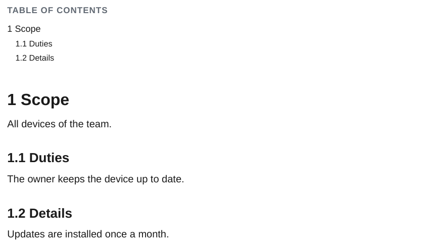

</div>
</div>

## Lists and tasks

### List items

Lists are compared line by line, so each item keeps its marker and its place. A changed item shows the word changes, an inserted item is green and a removed item stays in place, struck through. Nested items work the same way.

The numbers of an ordered list come from the newer version, so a removed item shifts the numbers below it. When several neighbouring lines change at once, they are shown as whole removed and inserted items, as with "Sign the form." here ([#89](https://github.com/Spenhouet/obsidian-pdf-exporter/issues/89)).

<div class="ope-example ope-redline" markdown>
<div markdown>
<p class="ope-label">Before</p>

````markdown
--8<-- "examples/_redline/lists/before/Policy/Policy.md"
````

</div>
<div markdown>
<p class="ope-label">After</p>

````markdown
--8<-- "examples/_redline/lists/after/Policy/Policy.md"
````

</div>
<div markdown class="ope-redline-pdf">
<p class="ope-label">Redline PDF</p>

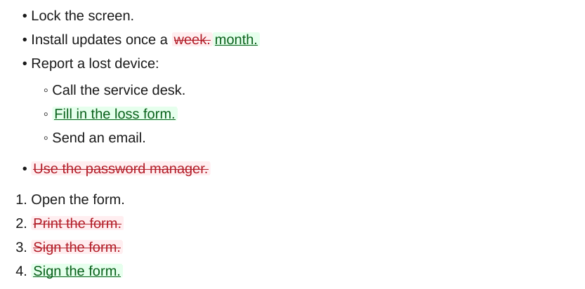

</div>
</div>

### Tasks

!!! warning "Known issue #85"
    Checking or unchecking a task shows the brackets as text instead of a checkbox. See [#85](https://github.com/Spenhouet/obsidian-pdf-exporter/issues/85).

<div class="ope-example ope-redline" markdown>
<div markdown>
<p class="ope-label">Before</p>

````markdown
--8<-- "examples/_redline/tasks/before/Policy/Policy.md"
````

</div>
<div markdown>
<p class="ope-label">After</p>

````markdown
--8<-- "examples/_redline/tasks/after/Policy/Policy.md"
````

</div>
<div markdown class="ope-redline-pdf">
<p class="ope-label">Redline PDF</p>


</div>
</div>

## Tables

### Table cells

When the rows and the column widths stay the same, a changed cell shows the word changes inside the table.

<div class="ope-example ope-redline" markdown>
<div markdown>
<p class="ope-label">Before</p>

````markdown
--8<-- "examples/_redline/table-cells/before/Policy/Policy.md"
````

</div>
<div markdown>
<p class="ope-label">After</p>

````markdown
--8<-- "examples/_redline/table-cells/after/Policy/Policy.md"
````

</div>
<div markdown class="ope-redline-pdf">
<p class="ope-label">Redline PDF</p>

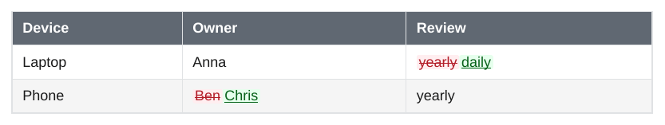

</div>
</div>

### Table rows

!!! warning "Known issue #80"
    An inserted or removed row, or a column that gets wider in the Markdown source, breaks the table: the marks cross the cell borders and the rows come out as text with pipes. Until this is fixed, keep the column widths of the source unchanged (pad the cells) when a table changes, or review table changes in the normal export. See [#80](https://github.com/Spenhouet/obsidian-pdf-exporter/issues/80).

<div class="ope-example ope-redline" markdown>
<div markdown>
<p class="ope-label">Before</p>

````markdown
--8<-- "examples/_redline/table-rows/before/Policy/Policy.md"
````

</div>
<div markdown>
<p class="ope-label">After</p>

````markdown
--8<-- "examples/_redline/table-rows/after/Policy/Policy.md"
````

</div>
<div markdown class="ope-redline-pdf">
<p class="ope-label">Redline PDF</p>

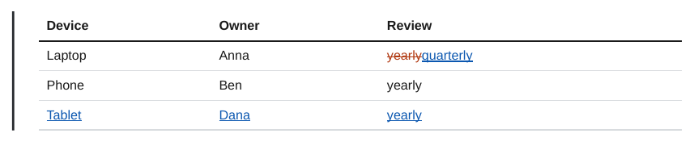

</div>
</div>

## Callouts

### Text inside a callout

A change inside a callout that stays in place shows the word changes inside the callout box.

<div class="ope-example ope-redline" markdown>
<div markdown>
<p class="ope-label">Before</p>

````markdown
--8<-- "examples/_redline/callout-text/before/Policy/Policy.md"
````

</div>
<div markdown>
<p class="ope-label">After</p>

````markdown
--8<-- "examples/_redline/callout-text/after/Policy/Policy.md"
````

</div>
<div markdown class="ope-redline-pdf">
<p class="ope-label">Redline PDF</p>


</div>
</div>

### Inserted and removed callouts

!!! warning "Known issue #83"
    An inserted or removed callout, or one whose title and body both change, is split: the title and the body end up in separate boxes. See [#83](https://github.com/Spenhouet/obsidian-pdf-exporter/issues/83).

<div class="ope-example ope-redline" markdown>
<div markdown>
<p class="ope-label">Before</p>

````markdown
--8<-- "examples/_redline/callout-blocks/before/Policy/Policy.md"
````

</div>
<div markdown>
<p class="ope-label">After</p>

````markdown
--8<-- "examples/_redline/callout-blocks/after/Policy/Policy.md"
````

</div>
<div markdown class="ope-redline-pdf">
<p class="ope-label">Redline PDF</p>

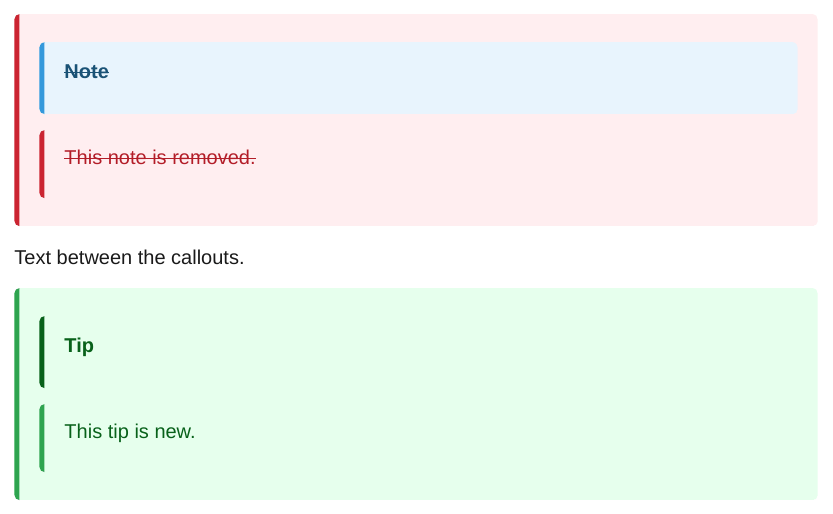

</div>
</div>

## Images and embeds

### Images

!!! warning "Known issue #84"
    A replaced image is not marked. Both the old and the new image are shown, one after the other, without a red or green mark, and with a size such as `|300` the attributes of the images show up as text. Name the change in the text next to the image so the reader notices it. See [#84](https://github.com/Spenhouet/obsidian-pdf-exporter/issues/84).

<div class="ope-example ope-redline" markdown>
<div markdown>
<p class="ope-label">Before</p>

````markdown
--8<-- "examples/_redline/images/before/Policy/Policy.md"
````

</div>
<div markdown>
<p class="ope-label">After</p>

````markdown
--8<-- "examples/_redline/images/after/Policy/Policy.md"
````

</div>
<div markdown class="ope-redline-pdf">
<p class="ope-label">Redline PDF</p>

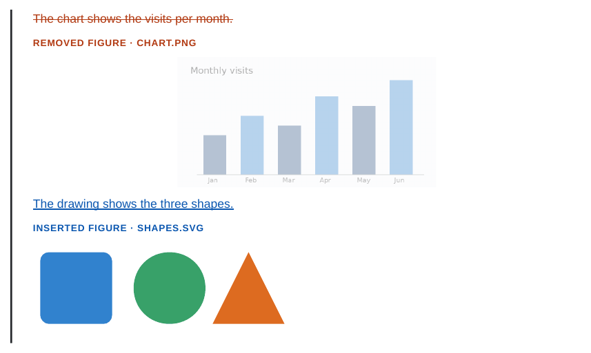

</div>
</div>

### Embedded notes

Embeds are expanded before the comparison, so a change in an embedded note shows up where it is embedded, even when the embedding note did not change.

<div class="ope-example ope-redline" markdown>
<div markdown>
<p class="ope-label">Before</p>

````markdown
--8<-- "examples/_redline/embeds/before/Policy/Policy.md"
````

</div>
<div markdown>
<p class="ope-label">After</p>

````markdown
--8<-- "examples/_redline/embeds/after/Policy/Policy.md"
````

</div>
<div markdown>
<p class="ope-label">Shared/Password rule.md before</p>

````markdown
--8<-- "examples/_redline/embeds/before/Shared/Password rule.md"
````

</div>
<div markdown>
<p class="ope-label">Shared/Password rule.md after</p>

````markdown
--8<-- "examples/_redline/embeds/after/Shared/Password rule.md"
````

</div>
<div markdown class="ope-redline-pdf">
<p class="ope-label">Redline PDF</p>


</div>
</div>

## Code

### Code blocks

!!! warning "Known issue #81"
    A change inside a fenced code block shows the `<del>` and `<ins>` tags as literal text, because code is not parsed as HTML. See [#81](https://github.com/Spenhouet/obsidian-pdf-exporter/issues/81).

<div class="ope-example ope-redline" markdown>
<div markdown>
<p class="ope-label">Before</p>

````markdown
--8<-- "examples/_redline/code/before/Policy/Policy.md"
````

</div>
<div markdown>
<p class="ope-label">After</p>

````markdown
--8<-- "examples/_redline/code/after/Policy/Policy.md"
````

</div>
<div markdown class="ope-redline-pdf">
<p class="ope-label">Redline PDF</p>

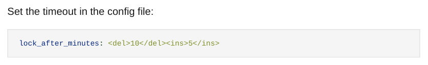

</div>
</div>

## Properties and plugins

### Properties and Meta Bind

The properties block is not part of the PDF, so a property change is only visible where the text shows the value. A Meta Bind `VIEW` field is filled in before the comparison, so its new value is marked like any other word. The change of `status` from `draft` to `approved` in this example is not visible, since no field shows it.

<div class="ope-example ope-redline" markdown>
<div markdown>
<p class="ope-label">Before</p>

````markdown
--8<-- "examples/_redline/properties/before/Policy/Policy.md"
````

</div>
<div markdown>
<p class="ope-label">After</p>

````markdown
--8<-- "examples/_redline/properties/after/Policy/Policy.md"
````

</div>
<div markdown class="ope-redline-pdf">
<p class="ope-label">Redline PDF</p>


</div>
</div>

### Dataview

Dataview queries run on each version of the vault before the comparison, so the result table is compared like a normal table: changed values are marked in their cells.

!!! warning "Known issue #80"
    In this example `Alpha` changed to `done` and `Gamma` was added. The changed value and the result count are marked, but the new row breaks the table, as for [table rows](#table-rows) ([#80](https://github.com/Spenhouet/obsidian-pdf-exporter/issues/80)).

<div class="ope-example ope-redline" markdown>
<div markdown>
<p class="ope-label">Before</p>

````markdown
--8<-- "examples/_redline/dataview/before/Policy/Policy.md"
````

</div>
<div markdown>
<p class="ope-label">After</p>

````markdown
--8<-- "examples/_redline/dataview/after/Policy/Policy.md"
````

</div>
<div markdown>
<p class="ope-label">Projects/Alpha.md before</p>

````markdown
--8<-- "examples/_redline/dataview/before/Projects/Alpha.md"
````

</div>
<div markdown>
<p class="ope-label">Projects/Alpha.md after</p>

````markdown
--8<-- "examples/_redline/dataview/after/Projects/Alpha.md"
````

</div>
<div></div>
<div markdown>
<p class="ope-label">Projects/Gamma.md after (new)</p>

````markdown
--8<-- "examples/_redline/dataview/after/Projects/Gamma.md"
````

</div>
<div markdown class="ope-redline-pdf">
<p class="ope-label">Redline PDF</p>

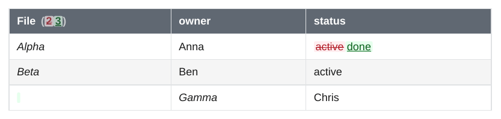

</div>
</div>

## Footnotes

### Footnote text

!!! warning "Known issue #87"
    A changed footnote is shown in the footnote area at the bottom of the page: the old note struck through, the new one inserted, each with its own number. In the text, two empty colored boxes are left where the definitions were. See [#87](https://github.com/Spenhouet/obsidian-pdf-exporter/issues/87).

<div class="ope-example ope-redline" markdown>
<div markdown>
<p class="ope-label">Before</p>

````markdown
--8<-- "examples/_redline/footnotes/before/Policy/Policy.md"
````

</div>
<div markdown>
<p class="ope-label">After</p>

````markdown
--8<-- "examples/_redline/footnotes/after/Policy/Policy.md"
````

</div>
<div markdown class="ope-redline-pdf">
<p class="ope-label">Redline PDF</p>

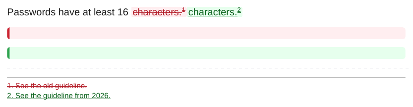

</div>
</div>
