# What changes look like

Each case below shows the note in the older commit, the note in the newer commit and the redline PDF made from the two with the built-in `redline` template, in the blackline style and in the [side-by-side style](styles.md#side-by-side). The examples live in [`examples/_redline/`](https://github.com/Spenhouet/obsidian-pdf-exporter/tree/main/examples/_redline), and `scripts/render_redline_examples.py` makes the pictures from them in a temporary git repository. The change summary at the start of every redline is left out of these pictures; [Styles and options](styles.md) shows it.

## Summary

| Change | Blackline | Side by side |
| ------ | --------- | ------------ |
| Words inside a paragraph | Removed words struck through, inserted words underlined | The same marks, old words left, new words right |
| Paragraph inserted or removed | The whole paragraph marked | The paragraph faces a gap |
| Paragraph replaced by a different one | Removed paragraph, then inserted paragraph | Old and new paragraph on one row |
| Paragraph moved | Purple at both places, each linked to the other | Purple, each facing a "moved" gap |
| Heading text | Word marks, also in the table of contents | Old and new heading on one row |
| Heading inserted or removed | Marked heading; a removed heading stays out of the numbering and is listed struck through in the table of contents | Faces a gap |
| Heading level | "level 2 → 3" label | The same label |
| List item changed, inserted, removed, reordered | Marks per item; a reordered item is shown as moved | One row per item |
| Task checked or unchecked | The new checkbox with a "now checked" label | Old and new checkbox |
| Table cell, row, column | Marks per cell; inserted and removed rows and an added column marked as a whole | Old and new table on one row |
| Callout text, callout inserted or removed | Marks inside the callout; a whole callout marked as one block | Old and new callout on one row |
| Image or diagram replaced, also by a new file of the same name | Removed figure faded and labelled, inserted figure labelled | Old and new figure on one row |
| Code block | Changed lines: the old line struck through, then the new line | Old code left, new code right |
| Embedded note, Meta Bind value, Dataview result | Marked where they appear in the PDF | The same |
| Property that is not shown in the text | Not shown | Not shown |
| Footnote text | Marks in the footnote | The old footnote inline in the old column |

## Text

### Words inside a paragraph

Inserted words are blue with a double underline, removed words vermilion and struck through. A replaced word is shown as the old word followed by the new one. Neighbouring changes that are only split by a short word are joined into one, so a rewritten phrase reads as one replacement. Words are split at spaces, so a full stop or comma belongs to the word before it.

<div class="ope-example ope-redline" markdown>
<div markdown>
<p class="ope-label">Before</p>

````markdown
--8<-- "examples/_redline/words/before/Policy/Policy.md"
````

</div>
<div markdown>
<p class="ope-label">After</p>

````markdown
--8<-- "examples/_redline/words/after/Policy/Policy.md"
````

</div>
<div markdown class="ope-redline-pdf">
<p class="ope-label">Redline PDF</p>

=== "Blackline"

    

=== "Side by side"

    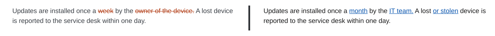

</div>
</div>

### Inserted and removed paragraphs

A paragraph that is only in one version is marked as a whole: underlined when it is inserted, struck through when it is removed. The bar in the margin marks the group of changed blocks.

<div class="ope-example ope-redline" markdown>
<div markdown>
<p class="ope-label">Before</p>

````markdown
--8<-- "examples/_redline/blocks/before/Policy/Policy.md"
````

</div>
<div markdown>
<p class="ope-label">After</p>

````markdown
--8<-- "examples/_redline/blocks/after/Policy/Policy.md"
````

</div>
<div markdown class="ope-redline-pdf">
<p class="ope-label">Redline PDF</p>

=== "Blackline"

    

=== "Side by side"

    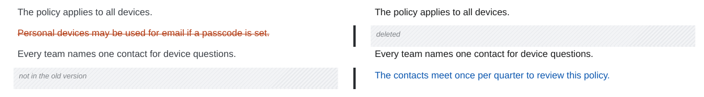

</div>
</div>

### Moved text

A paragraph that was removed in one place and inserted in another with the same or nearly the same text is shown as moved: purple and struck through where it was, purple and underlined where it is now. A label at each end names the section of the other end, with its page, and links to it. When the moved text was also edited, the new place shows the word changes too.

<div class="ope-example ope-redline" markdown>
<div markdown>
<p class="ope-label">Before</p>

````markdown
--8<-- "examples/_redline/moved/before/Policy/Policy.md"
````

</div>
<div markdown>
<p class="ope-label">After</p>

````markdown
--8<-- "examples/_redline/moved/after/Policy/Policy.md"
````

</div>
<div markdown class="ope-redline-pdf">
<p class="ope-label">Redline PDF</p>

=== "Blackline"

    

=== "Side by side"

    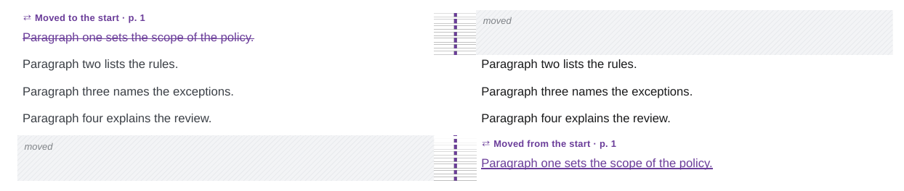

</div>
</div>

### Replaced paragraphs

Blocks are only compared word by word when they are alike: at least half of their words match. A paragraph replaced by one with a different content is shown as a removed paragraph followed by an inserted one, not as a mix of single words. A changed paragraph next to an inserted or removed one is still compared word by word.

<div class="ope-example ope-redline" markdown>
<div markdown>
<p class="ope-label">Before</p>

````markdown
--8<-- "examples/_redline/replaced/before/Policy/Policy.md"
````

</div>
<div markdown>
<p class="ope-label">After</p>

````markdown
--8<-- "examples/_redline/replaced/after/Policy/Policy.md"
````

</div>
<div markdown class="ope-redline-pdf">
<p class="ope-label">Redline PDF</p>

=== "Blackline"

    

=== "Side by side"

    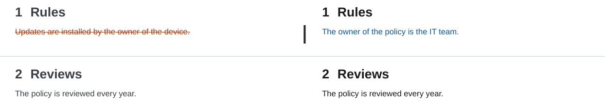

</div>
</div>

## Headings

### Changed, inserted and removed headings

A changed heading keeps its place and number and shows the word changes, also in the table of contents. An inserted heading is marked and gets a number; the table of contents marks it "new". A removed heading is shown struck through but is not a heading any more, so it gets no number, does not shift the numbering of the following sections, and is listed struck through, as "removed", in the table of contents.

<div class="ope-example ope-redline" markdown>
<div markdown>
<p class="ope-label">Before</p>

````markdown
--8<-- "examples/_redline/headings/before/Policy/Policy.md"
````

</div>
<div markdown>
<p class="ope-label">After</p>

````markdown
--8<-- "examples/_redline/headings/after/Policy/Policy.md"
````

</div>
<div markdown class="ope-redline-pdf">
<p class="ope-label">Redline PDF</p>

=== "Blackline"

    

=== "Side by side"

    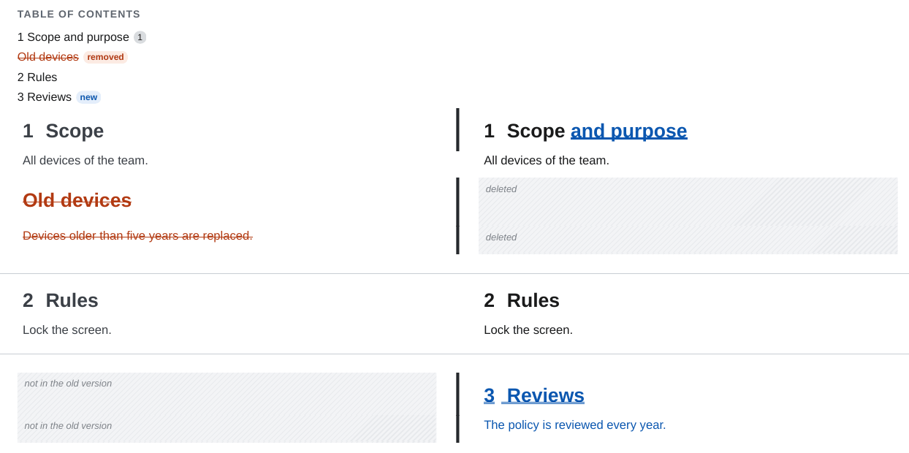

</div>
</div>

### Heading level

A heading that changes its level keeps its text and gets a small label with the old and the new level. The numbers of the heading and of the headings below it change with it.

<div class="ope-example ope-redline" markdown>
<div markdown>
<p class="ope-label">Before</p>

````markdown
--8<-- "examples/_redline/heading-level/before/Policy/Policy.md"
````

</div>
<div markdown>
<p class="ope-label">After</p>

````markdown
--8<-- "examples/_redline/heading-level/after/Policy/Policy.md"
````

</div>
<div markdown class="ope-redline-pdf">
<p class="ope-label">Redline PDF</p>

=== "Blackline"

    

=== "Side by side"

    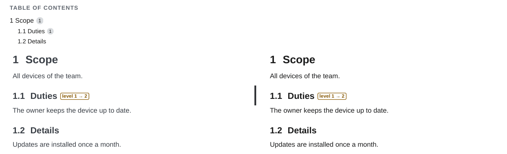

</div>
</div>

## Lists and tasks

### List items

Lists are compared item by item, so each item keeps its marker and its place. Items are paired by similarity, so a changed item next to an inserted or removed one is still compared word by word. An item that only changed its place in the list is shown as moved. Nested items work the same way. The numbers of an ordered list come from the newer version.

<div class="ope-example ope-redline" markdown>
<div markdown>
<p class="ope-label">Before</p>

````markdown
--8<-- "examples/_redline/lists/before/Policy/Policy.md"
````

</div>
<div markdown>
<p class="ope-label">After</p>

````markdown
--8<-- "examples/_redline/lists/after/Policy/Policy.md"
````

</div>
<div markdown class="ope-redline-pdf">
<p class="ope-label">Redline PDF</p>

=== "Blackline"

    

=== "Side by side"

    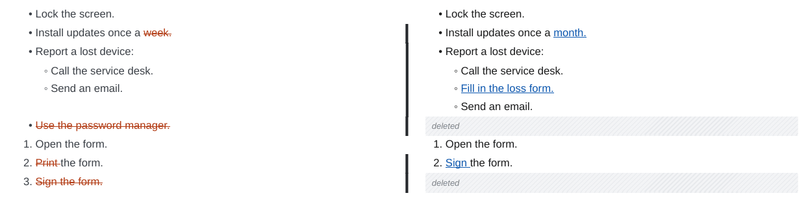

</div>
</div>

### Tasks

A task that was checked or unchecked keeps its checkbox, which shows the new state, and gets a "now checked" or "now unchecked" label.

<div class="ope-example ope-redline" markdown>
<div markdown>
<p class="ope-label">Before</p>

````markdown
--8<-- "examples/_redline/tasks/before/Policy/Policy.md"
````

</div>
<div markdown>
<p class="ope-label">After</p>

````markdown
--8<-- "examples/_redline/tasks/after/Policy/Policy.md"
````

</div>
<div markdown class="ope-redline-pdf">
<p class="ope-label">Redline PDF</p>

=== "Blackline"

    

=== "Side by side"

    

</div>
</div>

## Tables

### Table cells

A changed cell shows the word changes inside the table. Padding and column widths in the Markdown source do not matter.

<div class="ope-example ope-redline" markdown>
<div markdown>
<p class="ope-label">Before</p>

````markdown
--8<-- "examples/_redline/table-cells/before/Policy/Policy.md"
````

</div>
<div markdown>
<p class="ope-label">After</p>

````markdown
--8<-- "examples/_redline/table-cells/after/Policy/Policy.md"
````

</div>
<div markdown class="ope-redline-pdf">
<p class="ope-label">Redline PDF</p>

=== "Blackline"

    

=== "Side by side"

    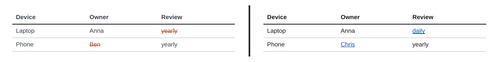

</div>
</div>

### Table rows

Tables are compared row by row and cell by cell. An inserted row is underlined as a whole, a removed row stays in place struck through, and a column that was added is marked in every cell. The table stays a table, also when the source columns get wider.

<div class="ope-example ope-redline" markdown>
<div markdown>
<p class="ope-label">Before</p>

````markdown
--8<-- "examples/_redline/table-rows/before/Policy/Policy.md"
````

</div>
<div markdown>
<p class="ope-label">After</p>

````markdown
--8<-- "examples/_redline/table-rows/after/Policy/Policy.md"
````

</div>
<div markdown class="ope-redline-pdf">
<p class="ope-label">Redline PDF</p>

=== "Blackline"

    

=== "Side by side"

    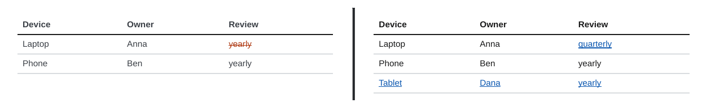

</div>
</div>

## Callouts

### Text inside a callout

A change inside a callout that stays in place shows the word changes inside the callout box.

<div class="ope-example ope-redline" markdown>
<div markdown>
<p class="ope-label">Before</p>

````markdown
--8<-- "examples/_redline/callout-text/before/Policy/Policy.md"
````

</div>
<div markdown>
<p class="ope-label">After</p>

````markdown
--8<-- "examples/_redline/callout-text/after/Policy/Policy.md"
````

</div>
<div markdown class="ope-redline-pdf">
<p class="ope-label">Redline PDF</p>

=== "Blackline"

    

=== "Side by side"

    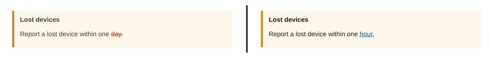

</div>
</div>

### Inserted and removed callouts

A callout that is only in one version is marked as a whole, title and body together.

<div class="ope-example ope-redline" markdown>
<div markdown>
<p class="ope-label">Before</p>

````markdown
--8<-- "examples/_redline/callout-blocks/before/Policy/Policy.md"
````

</div>
<div markdown>
<p class="ope-label">After</p>

````markdown
--8<-- "examples/_redline/callout-blocks/after/Policy/Policy.md"
````

</div>
<div markdown class="ope-redline-pdf">
<p class="ope-label">Redline PDF</p>

=== "Blackline"

    

=== "Side by side"

    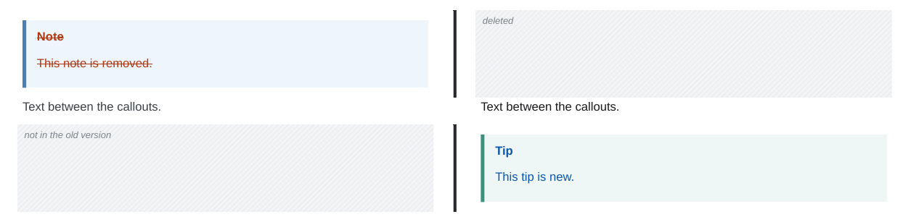

</div>
</div>

## Images and embeds

### Images

A replaced image is shown twice: the old one faded under a "Removed figure" label with its file name, the new one under an "Inserted figure" label. Size attributes such as `|300` are kept. A changed Mermaid diagram is shown the same way, with both drawings.

<div class="ope-example ope-redline" markdown>
<div markdown>
<p class="ope-label">Before</p>

````markdown
--8<-- "examples/_redline/images/before/Policy/Policy.md"
````

</div>
<div markdown>
<p class="ope-label">After</p>

````markdown
--8<-- "examples/_redline/images/after/Policy/Policy.md"
````

</div>
<div markdown class="ope-redline-pdf">
<p class="ope-label">Redline PDF</p>

=== "Blackline"

    

=== "Side by side"

    

</div>
</div>

### Image files with the same name

Images are compared by their file content, not only by the name in the note. An image file that keeps its name and path but has a new picture is shown as replaced, in the same way as an image that was renamed. The same holds for SVG files, embedded PDF pages, draw.io and Excalidraw drawings, and images inside embedded notes. Files with the same bytes in both versions are not marked, even when they moved to another folder. An Excalidraw drawing is compared by the picture that is drawn from it, so an edit of the drawing file that does not change the picture is not marked. The label of a drawing shows its name, such as `Drawing.excalidraw`.

<div class="ope-example ope-redline" markdown>
<div markdown>
<p class="ope-label">Before</p>

````markdown
--8<-- "examples/_redline/image-file/before/Policy/Policy.md"
````

</div>
<div markdown>
<p class="ope-label">After (same text, new `visits.png`)</p>

````markdown
--8<-- "examples/_redline/image-file/after/Policy/Policy.md"
````

</div>
<div markdown class="ope-redline-pdf">
<p class="ope-label">Redline PDF</p>

=== "Blackline"

    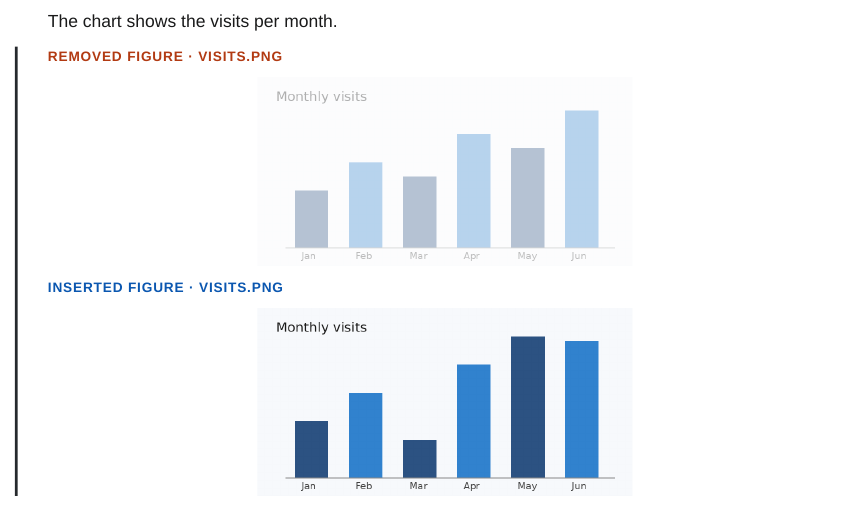

=== "Side by side"

    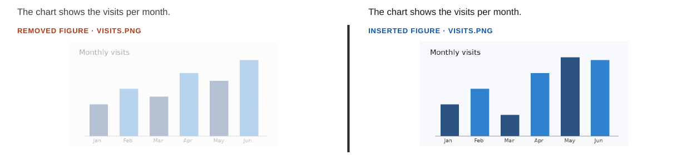

</div>
</div>

### Embedded notes

Embeds are expanded before the comparison, so a change in an embedded note shows up where it is embedded, even when the embedding note did not change.

<div class="ope-example ope-redline" markdown>
<div markdown>
<p class="ope-label">Before</p>

````markdown
--8<-- "examples/_redline/embeds/before/Policy/Policy.md"
````

</div>
<div markdown>
<p class="ope-label">After</p>

````markdown
--8<-- "examples/_redline/embeds/after/Policy/Policy.md"
````

</div>
<div markdown class="ope-redline-pdf">
<p class="ope-label">Redline PDF</p>

=== "Blackline"

    

=== "Side by side"

    

</div>
</div>

## Code

### Code blocks

A changed code block is compared line by line. A changed line is shown twice, the old line with the removed characters struck through and the new line with the inserted ones underlined. Inserted and removed lines are marked as a whole.

<div class="ope-example ope-redline" markdown>
<div markdown>
<p class="ope-label">Before</p>

````markdown
--8<-- "examples/_redline/code/before/Policy/Policy.md"
````

</div>
<div markdown>
<p class="ope-label">After</p>

````markdown
--8<-- "examples/_redline/code/after/Policy/Policy.md"
````

</div>
<div markdown class="ope-redline-pdf">
<p class="ope-label">Redline PDF</p>

=== "Blackline"

    

=== "Side by side"

    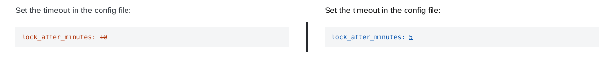

</div>
</div>

## Properties and plugins

### Properties and Meta Bind

The properties block is not part of the PDF, so a property change is only visible where the text shows the value. A Meta Bind `VIEW` field is filled in before the comparison, so its new value is marked like any other word. The change of `status` from `draft` to `approved` in this example is not visible, since no field shows it.

<div class="ope-example ope-redline" markdown>
<div markdown>
<p class="ope-label">Before</p>

````markdown
--8<-- "examples/_redline/properties/before/Policy/Policy.md"
````

</div>
<div markdown>
<p class="ope-label">After</p>

````markdown
--8<-- "examples/_redline/properties/after/Policy/Policy.md"
````

</div>
<div markdown class="ope-redline-pdf">
<p class="ope-label">Redline PDF</p>

=== "Blackline"

    

=== "Side by side"

    

</div>
</div>

### Dataview

Dataview queries run on each version of the vault before the comparison, so the result table is compared like any table: changed values are marked in their cells, and a note that now matches the query is an inserted row.

<div class="ope-example ope-redline" markdown>
<div markdown>
<p class="ope-label">Before</p>

````markdown
--8<-- "examples/_redline/dataview/before/Policy/Policy.md"
````

</div>
<div markdown>
<p class="ope-label">After</p>

````markdown
--8<-- "examples/_redline/dataview/after/Policy/Policy.md"
````

</div>
<div markdown class="ope-redline-pdf">
<p class="ope-label">Redline PDF</p>

=== "Blackline"

    

=== "Side by side"

    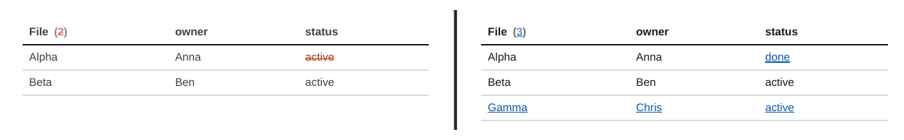

</div>
</div>

## Footnotes

### Footnote text

A changed footnote shows the word changes in the footnote at the bottom of the page.

<div class="ope-example ope-redline" markdown>
<div markdown>
<p class="ope-label">Before</p>

````markdown
--8<-- "examples/_redline/footnotes/before/Policy/Policy.md"
````

</div>
<div markdown>
<p class="ope-label">After</p>

````markdown
--8<-- "examples/_redline/footnotes/after/Policy/Policy.md"
````

</div>
<div markdown class="ope-redline-pdf">
<p class="ope-label">Redline PDF</p>

=== "Blackline"

    

=== "Side by side"

    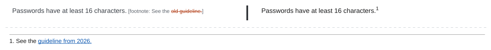

</div>
</div>
