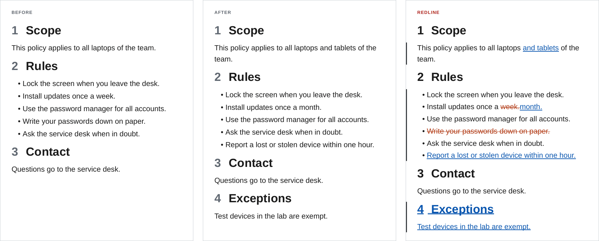
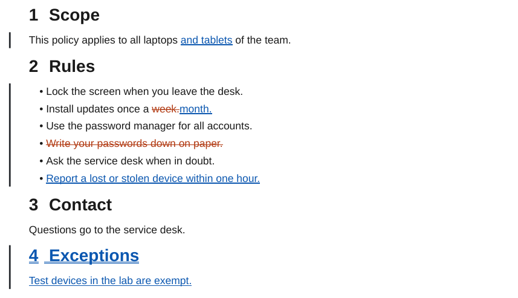

# Redline

`ope redline` builds a tracked-changes PDF of a folder between two git commits, or between two folders or notes on disk. Inserted text is blue and underlined, removed text is vermilion and struck through, moved text is purple, and a bar in the margin marks every change. The rest of the document is exactly as it is in the newer commit, so a reader sees every change in context, in the same layout as the released PDF.

```bash
ope redline ./Policy --from-commit v1.0.0 --to-commit v1.1.0
ope redline ./Policy --from-commit v1.0.0 -O redline.style=side-by-side   # old | new in two columns
ope redline ./Policy --from-commit v1.0.0 -O redline.collapse=on          # only the changes
ope redline ./Policy --from-commit v1.0.0 --blame                         # who changed what, and why
ope redline ./Policy --from-path ./old/Policy                             # two folders, no git
```



## Who it is for

A redline answers "what changed since the version I approved?" without a diff tool and without reading Markdown. Typical uses:

- Document control: every new release of a procedure, policy or manual goes out with a redline against the previous release.
- Reviews and approvals: the reviewer of a pull request reads the redline PDF instead of the raw diff.
- Audits: the change history of a controlled document can be shown for any two versions, at any time, from the git history.
- Change requests: the PDF of a proposed change is attached to the request, so the people who decide see the exact wording.

## How it works

1. Both commits are taken from git with `git archive`. Uncommitted changes in the working tree are not part of either version. With `--from-path`, both versions are read from disk instead.
2. Each version of the folder is assembled into one Markdown document with the same steps and plugins as `ope export`. Embeds are expanded, Dataview queries run and Meta Bind values are filled in, so the two documents are compared as they appear in the PDF.
3. The two documents are split into blocks at blank lines (paragraphs, list blocks, tables, headings, code blocks) and the blocks are compared.
4. Blocks that are alike are paired. A paired block is compared word by word (lists item by item, tables cell by cell, code line by line) and gets inline `<ins>` and `<del>` marks. A block that only exists in one version is shown as a whole inserted or removed block, and a block that was removed in one place and inserted in another is shown as moved.
5. The result goes through the rest of the export (callouts, links, numbering, table of contents). Then the change summary is added and the document is laid out in the chosen [style](styles.md), with the [`redline` template](styling.md).

## What the reader sees



- A change summary after the title: the two versions, the number of changes of each kind, the changed sections with their page numbers and the commits in between.
- Inserted words: blue with a double underline. Removed words: vermilion and struck through. A replaced passage shows the old words, then the new ones.
- Inserted and removed blocks (paragraphs, list items, table rows, callouts, figures, code lines) are marked the same way as a whole; a removed figure is faded and labelled.
- Moved text: purple, with a link from each end to the other.
- A black bar in the left margin next to every group of changed blocks.
- Changed headings show their word changes, also in the table of contents, which counts the changes per section, marks new sections and lists removed headings struck through. A changed heading level gets a small label.
- The [side-by-side style](styles.md#side-by-side) shows the old and the new document in two aligned columns instead.

[What changes look like](changes.md) shows every kind of change in both styles.
## In this section

| Page | Content |
| ---- | ------- |
| [Usage](usage.md) | The command and every flag, default names, one document or a folder, and CI workflows. |
| [Comparing versions](compare.md) | Tags, branches, commits and `HEAD~n`, releases, pull requests, the history of one note, and two folders or notes without git. |
| [Styles and options](styles.md) | Blackline and side by side, collapsing unchanged content and the blame strip, with every combination. |
| [What changes look like](changes.md) | Words, paragraphs, headings, lists, tables, callouts, images, embeds, properties and Dataview, each in both styles. |
| [Blame](blame.md) | The author, date and commit message of each block next to the page, for exports and redlines. |
| [Styling the redline](styling.md) | The `redline` template, the classes and variables a redline uses, and how to restyle them. |
| [Limitations and tips](limitations.md) | What a redline does not show, and how to get a clean one. |
