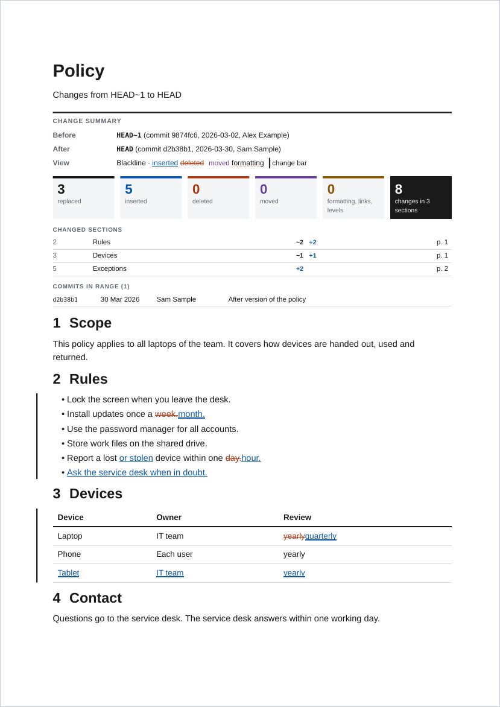
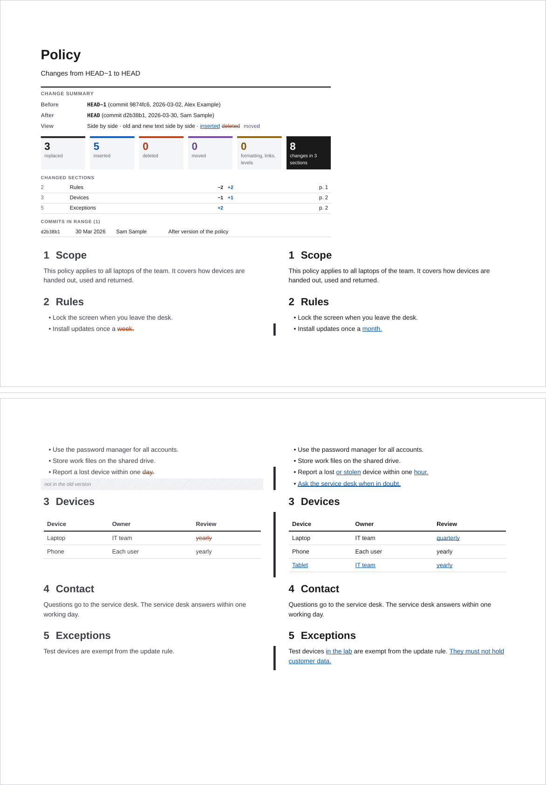
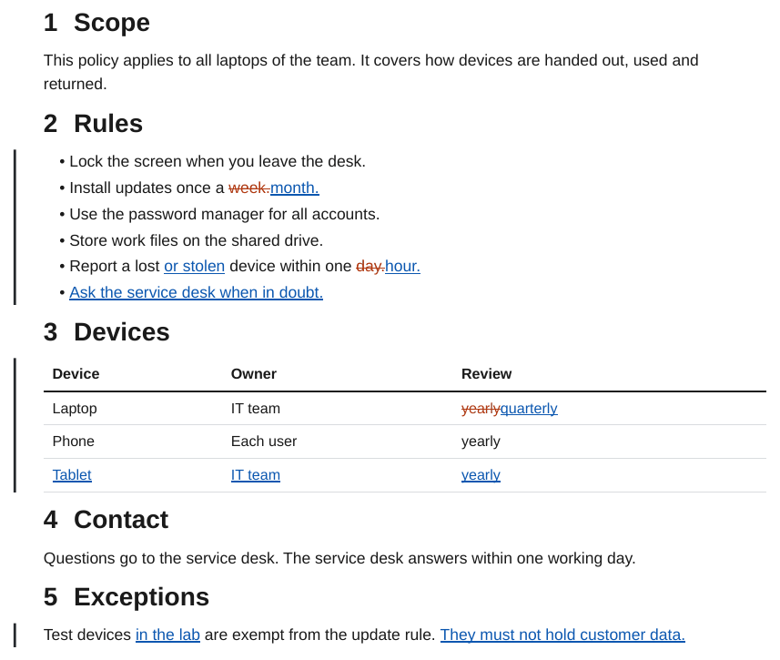
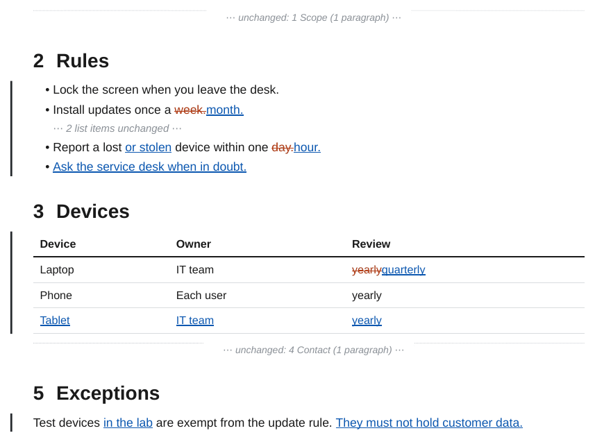
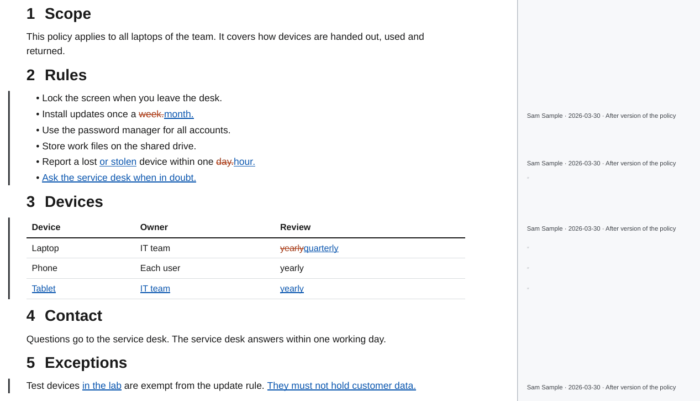
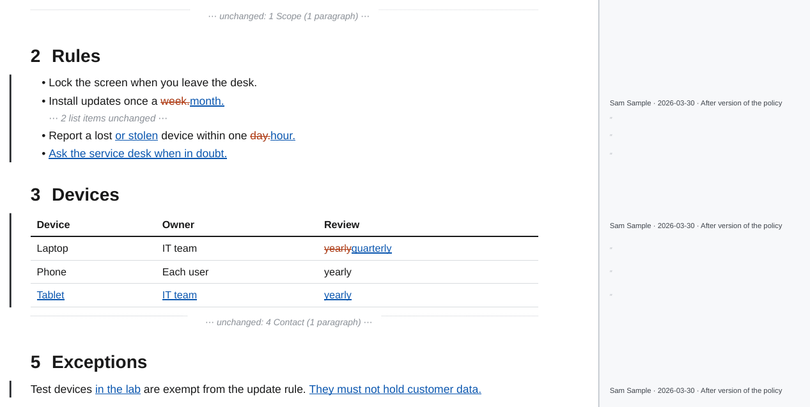
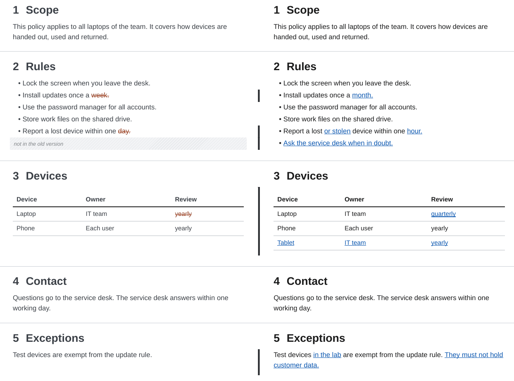
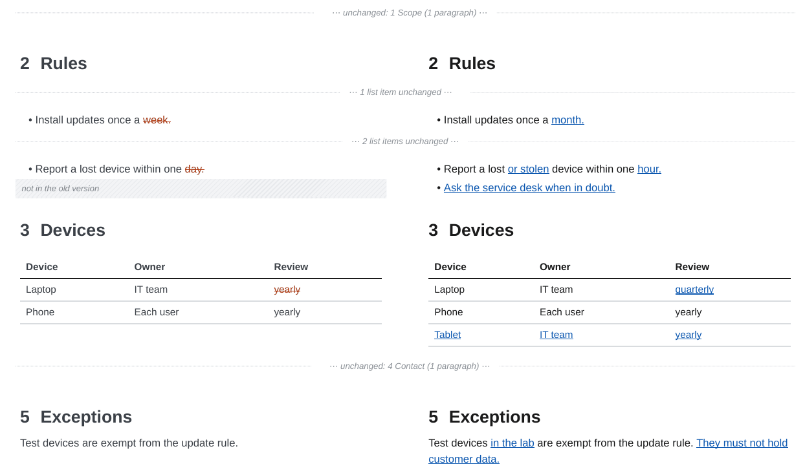
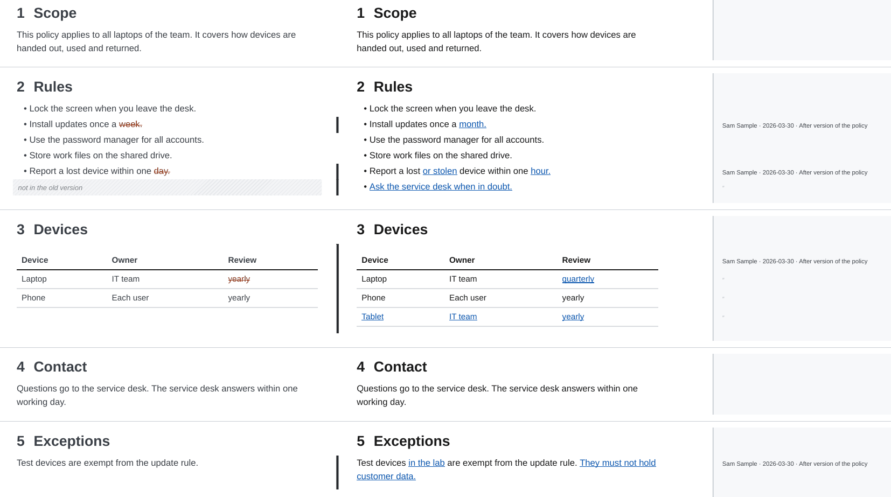
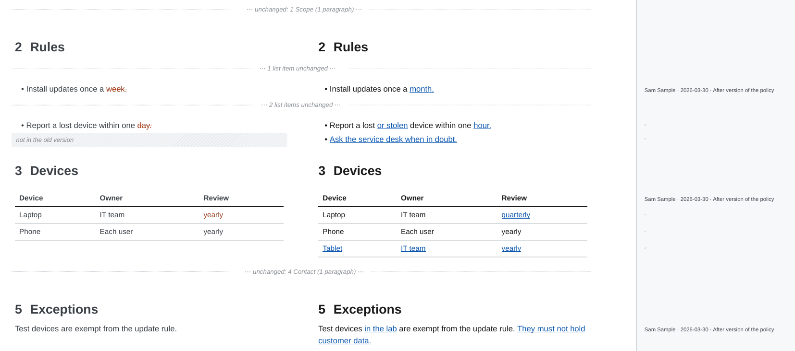

# Styles and options

A redline has two looks and two options that work with both:

| Option | Values | What it does |
| ------ | ------ | ------------ |
| `-O redline.style=` | `blackline` (default), `side-by-side` | Changes marked in the text of the new version, or the old and the new document in two aligned columns. |
| `-O redline.collapse=` | `off` (default), `on` | Show only the changes and the headings of their sections; each run of unchanged text becomes one line. |
| `--blame` | off | A strip next to every page with the author, date and commit message of the last change of each block. See [Blame](blame.md). |

```bash
ope redline ./Policy --from-commit v1.0.0                                  # blackline
ope redline ./Policy --from-commit v1.0.0 -O redline.style=side-by-side    # two columns
ope redline ./Policy --from-commit v1.0.0 -O redline.collapse=on           # only the changes
ope redline ./Policy --from-commit v1.0.0 --blame                          # who changed what
```

Every redline starts with a change summary after the title: the two versions with their commits, dates and authors, the number of replaced, inserted, deleted and moved passages and of other changes (formatting, link targets, heading levels, tasks), the changed sections with their page numbers, and the commits between the two versions. The table of contents shows the number of changes next to each changed section, marks new sections with "new" and lists removed headings struck through.

## Blackline

The default. The document is the new version, with every change marked where it happened:

- Inserted text is blue with a double underline, removed text vermilion and struck through. A replaced passage shows the old words followed by the new ones.
- Moved text is purple: struck through where it was, underlined where it is now. A label at each end names the section of the other end and links to it.
- A black bar in the left margin marks every group of changed blocks.
- Formatting changes, link targets, task states and heading levels get a dotted underline or a small label.

The colours are chosen so that inserted and removed text stay apart for readers with red-green colour blindness, and every change also has a form that survives greyscale printing (underline, strike-through, bar).



## Side by side

The old and the new document in two columns on landscape pages, in the page size of the template turned on its side (A4 landscape by default). Images are scaled down to the width of their column. Every block of the document sits on its own row, so the old and the new version of a paragraph, a list item or a table always start at the same height. A block that exists in only one version faces a hatched gap ("not in the old version", "deleted", "moved"). Every list item has a row of its own, so a long list stays aligned and can break between pages.

A thin bar between the columns marks the rows that changed; a moved block has a dashed purple bar. Word changes are marked in both columns: removed words in the old column, inserted words in the new one.



## Collapse unchanged content

With `-O redline.collapse=on` the redline shows only what changed. The heading of every section that contains a change stays, so the reader knows where a change is. Each run of unchanged blocks becomes one quiet line, for example "⋯ 2 paragraphs unchanged ⋯" or "⋯ unchanged: 4 Contact (1 paragraph) ⋯". Inside a changed list or table, a run of unchanged items or rows is collapsed the same way. Links from the table of contents, the summary and the text to collapsed headings and blocks still work: they point to the collapsed line. In the side-by-side style, a chapter without changes becomes one such line in the table of the chapter before it. A link to a heading that is not in the PDF at all, such as `[[#Typo]]`, stays as plain text, and the command prints a warning.

In the side-by-side style every row shown is a change, so the bar between the columns is left out.

## Every combination

The example below is a short policy with changed list items, a table with a new row, a changed paragraph and two sections that did not change. The version before was written by one author, the change by another, so the blame strip has two names.

<div class="ope-example ope-redline" markdown>
<div markdown>
<p class="ope-label">Before</p>

````markdown
--8<-- "examples/_redline/_styles/before/Policy/Policy.md"
````

</div>
<div markdown>
<p class="ope-label">After</p>

````markdown
--8<-- "examples/_redline/_styles/after/Policy/Policy.md"
````

</div>
<div markdown class="ope-redline-pdf">
<p class="ope-label">Redline PDF</p>

=== "Blackline"

    

=== "Blackline, collapsed"

    

=== "Blackline, blame"

    

=== "Blackline, collapsed, blame"

    

=== "Side by side"

    

=== "Side by side, collapsed"

    

=== "Side by side, blame"

    

=== "Side by side, collapsed, blame"

    

</div>
</div>

## Which one to use

- Blackline for review and approval of a new release: the reader sees the final text with every change in place, in the layout of the released document.
- Side by side when the old wording matters as much as the new one, for example for contracts, specifications or translated texts, and for tables and code that are easier to compare in two columns.
- Collapse for long documents with few changes, and for change requests where only the changes need a decision.
- Blame when a reviewer needs to know who changed a passage and why; the commit message says why.
