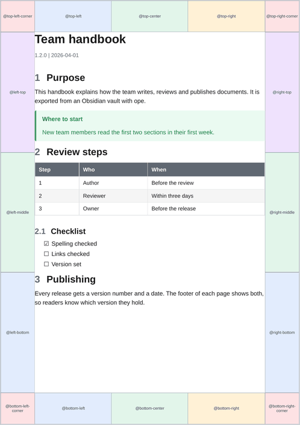

# Header and footer

Headers and footers are drawn in the page margins with [CSS Paged Media](https://www.w3.org/TR/css-page-3/). A template puts content there in three ways:

| Way | Content | Where it is defined |
| --- | ------- | ------------------- |
| Text and counters in a margin box | Fixed text, page numbers | `page.css`, or any CSS of the template |
| Named strings (`string-set`) | Text copied from the document, such as the title | `page.css` |
| Running elements (`position: running()`) | Any HTML: a logo, several lines, styled spans | `header.html` plus `page.css` |

## Margin boxes

Every page has 16 margin boxes around the page area. The page below is rendered by ope with a template that fills each box with its own name (`examples/_templates/margin-boxes/page.css`). Headers and footers mostly use the three boxes of the top and the bottom edge.

{ width="420" }

A box is only as wide as its content unless it gets a `width`. The three boxes of an edge share its width, so `width: 33.333%` gives each of them a third.

A box shows its `content`. Text, `counter(page)`, `counter(pages)`, `string(...)` and `element(...)` can be combined:

```css
@page {
  @bottom-right {
    content: "Page " counter(page) " of " counter(pages);
    font-family: Arial, sans-serif;
    font-size: 7pt;
    color: #606872;
  }
}
```

A margin box does not inherit the font of `body`. Set `font-family` and `font-size` in each box. `\A` in a string is a line break when the box has `white-space: pre`.

The margins of `@page` are the room for the boxes. A header that is 20pt tall in a 25mm top margin leaves about 5mm between the header and the text. Widen the margin or shrink the header.

## Named strings: text from the document

`string-set` copies the text of an element into a named string. A margin box shows it with `string()`. The title block that ope writes at the start of every document holds the title, subtitle and the version line:

```html
<header id="title-block-header">
  <h1 class="title">Team handbook</h1>
  <p class="subtitle">How we work</p>
  <p class="author">1.2.0 | 2026-04-01</p>
</header>
```

So a template folder, which has no Python, can still show them:

```css
header#title-block-header .title  { string-set: doc-title content(); }
header#title-block-header .author { string-set: doc-meta content(); }

@page {
  @top-left    { content: string(doc-title); }
  @bottom-left { content: string(doc-title) " · " string(doc-meta); }
}
```

The `author` line holds the version label and the date: `--version` or the short commit hash, then `--date`.

## Running elements: HTML in the margin

An element with `position: running(name)` is taken out of the page flow and can be placed in a margin box with `element(name)`. In a template folder, the elements are written in `header.html` (the `running_html` of `template.yaml`), which ope puts right after `<body>`:

```html title="header.html"

<div class="address">Example Ltd. · 1 Sample Street · 12345 Sample City</div>
```

```css title="page.css"
.logo    { position: running(logo); width: 40mm; }
.address { position: running(address); font-size: 7pt; }

@page {
  @top-right { content: element(logo); vertical-align: bottom; }
}
@page :first {
  @top-left { content: element(address); vertical-align: bottom; }
}
```

The `default` template uses a running element for its header too: `div.pdf-running-header` with `span.pdf-header-title` and `span.pdf-header-subtitle`, placed in `@top-left`.

A running element must come before the first page it appears on. Elements in `header.html` are at the very start of the document, so they show from page 1.

Images and fonts in `header.html` and `page.css` are turned into data URIs when the template is loaded, see [assets](folders.md#assets-logos-and-fonts).

## First page and other page selectors

```css
@page :first {
  margin-top: 40mm;                       /* room for a letterhead */
  @top-left { content: element(address); }
}
@page :first { @top-left { content: none; } }  /* no header on page 1 */
@page :left  { @bottom-left  { content: counter(page); } }
@page :right { @bottom-right { content: counter(page); } }
@page :blank { @top-left { content: none; } }
```

`:left` and `:right` are useful for printed, double-sided documents.

## Landscape pages

[Wide tables](../markdown/tables.md#wide-tables) and [wide diagrams](../obsidian/mermaid.md#wide-diagrams) are placed on a named page, `landscape-page`. A template that changes the page margins or the header should set them for that page too, or the landscape pages keep the old margins:

```css
@page landscape-page {
  size: A4 landscape;
  margin: 20mm 20mm 18mm 20mm;
  @top-left { content: string(doc-title); }
}
```

ope wraps each wide table and diagram in `.wide-table-section`. The template's CSS sends that wrapper to the named page. `default.css` does it like this, and a template written from scratch needs the same rules:

```css
@page landscape-page { size: A4 landscape; margin: 25mm 20mm 22mm 20mm; }
.wide-table-section { page: landscape-page; break-before: page; break-after: page; }
```

Margin boxes of the plain `@page` rule also apply to the named page unless the named page sets them.

## Escaping

- HTML in `header.html` or `running_html` must be valid: write `&amp;`, `&lt;` and `&quot;`.
- Text in a CSS string needs CSS escaping: `\` becomes `\\`, `"` becomes `\"` and a newline `\A `. Python templates build these strings from user data, so escape them there (see [Python templates](python.md)).
