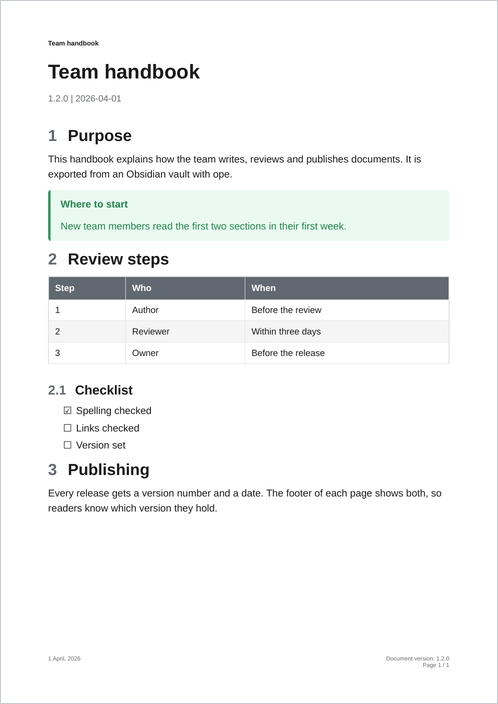
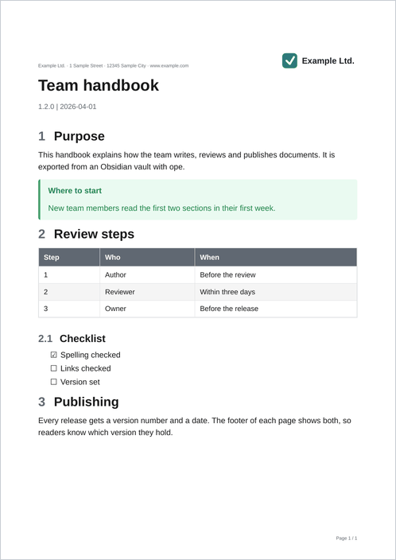
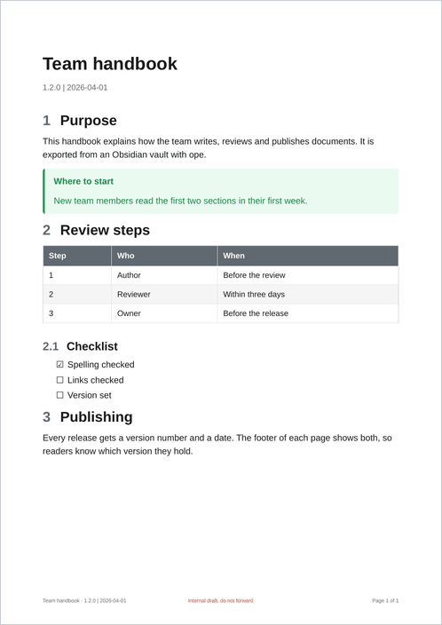
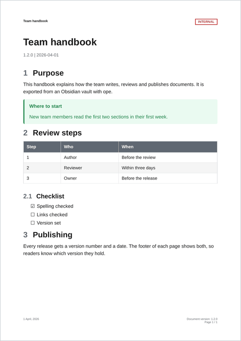
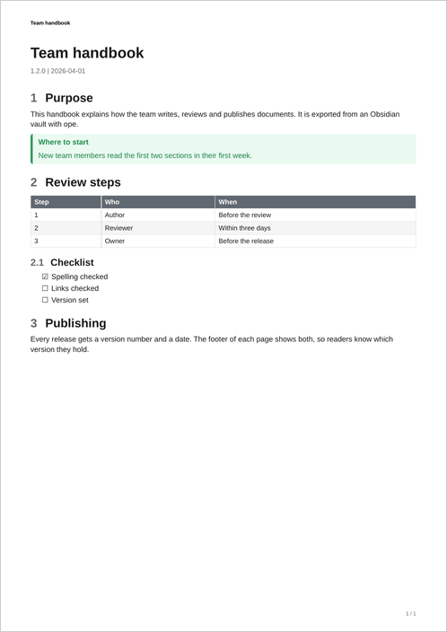
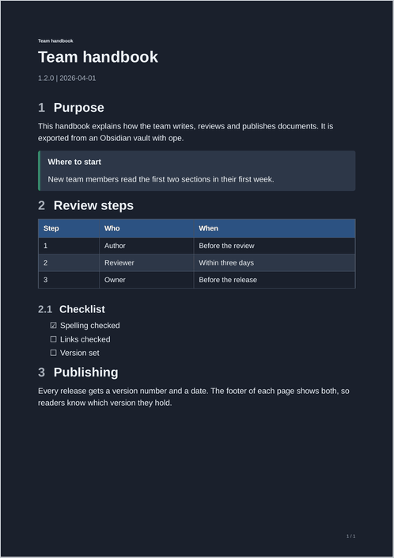

# Recipes

Each recipe is a complete template in [`examples/_templates/`](https://github.com/Spenhouet/obsidian-pdf-exporter/tree/main/examples/_templates). The pictures show the same sample page with the `default` template (left) and with the recipe (right), exported with:

```bash
ope export ./Handbook --title "Team handbook" --version 1.2.0 --date 2026-04-01 --no-toc -T <recipe>
```

The folder recipes keep only the rules they add in `custom.css`. To use one, put a copy of [`default.css`](https://github.com/Spenhouet/obsidian-pdf-exporter/blob/main/obsidian_pdf_exporter/templates/builtin/default/default.css) into the folder as `main.css` and append `custom.css` to it:

```bash
cp -r examples/_templates/letterhead examples/_templates/assets ~/.config/obsidian-pdf-exporter/templates/
cd ~/.config/obsidian-pdf-exporter/templates/letterhead
curl -sL https://raw.githubusercontent.com/Spenhouet/obsidian-pdf-exporter/main/obsidian_pdf_exporter/templates/builtin/default/default.css > main.css
cat custom.css >> main.css && rm custom.css
ope export ./Handbook -T letterhead
```

## Company letterhead

A logo at the top right of every page, the address on the first page, the document title on the following pages, and a teal accent colour.

<div class="ope-pages" markdown>
<figure markdown>

<figcaption>Before</figcaption>
</figure>
<figure markdown>

<figcaption>After</figcaption>
</figure>
</div>

=== "template.yaml"

    ```yaml
    --8<-- "examples/_templates/letterhead/template.yaml"
    ```

=== "header.html"

    ```html
    --8<-- "examples/_templates/letterhead/header.html"
    ```

=== "page.css"

    ```css
    --8<-- "examples/_templates/letterhead/page.css"
    ```

=== "custom.css"

    ```css
    --8<-- "examples/_templates/letterhead/custom.css"
    ```

The logo is `../assets/logo.svg`, a [shared asset](folders.md#sharing-assets-between-templates). It becomes a data URI when the template is loaded, so it shows inside the margin box.

## Change the footer text

Title and version line at the bottom left, a fixed notice in the middle, "Page X of Y" at the right. The header is left out. This recipe changes only `page.css`, so `main.css` is an unchanged copy of `default.css`.

<div class="ope-pages" markdown>
<figure markdown>

<figcaption>Before</figcaption>
</figure>
<figure markdown>

<figcaption>After</figcaption>
</figure>
</div>

=== "template.yaml"

    ```yaml
    --8<-- "examples/_templates/footer-text/template.yaml"
    ```

=== "page.css"

    ```css
    --8<-- "examples/_templates/footer-text/page.css"
    ```

## Confidentiality label

A label at the top right, set per export with `-O confidentiality=Internal`. The text comes from an option, so this is a [Python template](python.md). It extends `default` and keeps everything else.

<div class="ope-pages" markdown>
<figure markdown>

<figcaption>Before</figcaption>
</figure>
<figure markdown>

<figcaption>After, with <code>-O confidentiality=Internal</code></figcaption>
</figure>
</div>

```python title="confidential.py"
--8<-- "examples/_templates/confidential.py"
```

Register it as an entry point (see [Publish as a package](python.md#publish-as-a-package)) and export with:

```bash
ope export ./Handbook -T confidential -O confidentiality=Internal
```

For a fixed label, a folder template is enough: put `@top-right { content: "INTERNAL"; }` into its `page.css`.

## Compact variant

Smaller text, tighter spacing and narrow margins, for long reference documents.

<div class="ope-pages" markdown>
<figure markdown>

<figcaption>Before</figcaption>
</figure>
<figure markdown>

<figcaption>After</figcaption>
</figure>
</div>

=== "custom.css"

    ```css
    --8<-- "examples/_templates/compact/custom.css"
    ```

=== "page.css"

    ```css
    --8<-- "examples/_templates/compact/page.css"
    ```

=== "template.yaml"

    ```yaml
    --8<-- "examples/_templates/compact/template.yaml"
    ```

## Dark variant

Light text on a dark page, for reading on screens. Most of it is a change of the [colour variables](css-reference.md#colour-and-font-variables-of-default).

<div class="ope-pages" markdown>
<figure markdown>

<figcaption>Before</figcaption>
</figure>
<figure markdown>

<figcaption>After</figcaption>
</figure>
</div>

=== "custom.css"

    ```css
    --8<-- "examples/_templates/dark/custom.css"
    ```

=== "page.css"

    ```css
    --8<-- "examples/_templates/dark/page.css"
    ```

`@page { background: ... }` colours the whole sheet, margins included. `body` alone would leave a white border.
