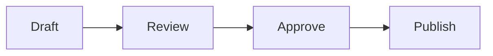

Every release follows the same four steps. New team members start with [[Onboarding]].

> [!warning] Feature freeze
> No new features in the ==last week== before a release.

## Who signs off

| Step    | Who      | When                |
| ------- | -------- | ------------------- |
| Review  | Reviewer | Within three days   |
| Approve | Owner    | Before the release  |

![[Terms#Release]]
